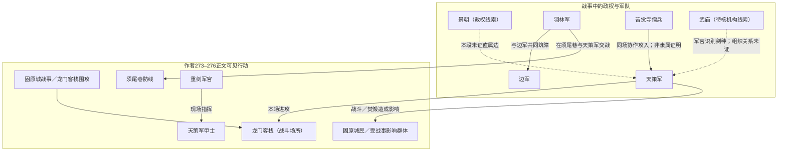

# 《全组织采集与世界体量树》阶段总图与总文件｜2026-11-14

> **范围声明**：本文件是当前聊天内已回读材料的阶段汇总，不是全书最终树。当前新近连续正文核查至作者276《兵主》；历史资料包含工单状态快照所记的221–265等分片。全书859章严格逐章PASS仍为0/859，组织去重与全树验收未完成，以下关系只表示有文本支撑的阶段关系。不得把目录、片段或未核章节当作PASS。

## 一、当前进度与断点
- 唯一主工单：674-334；In Progress / PARTIAL。
- 严格全书逐章PASS：0/859。
- 旧连续线索采矿：220/859 PROVISIONAL，不是全文核查完成数。
- 当前最新逐章证据：作者276《兵主》；下一断点作者277《天尊的认可》。
- 正文缺口：作者271《屠城》、272《转机》仍缺可审计的完整正文，不计PASS。
- 单源限制：作者274《围攻》正文已核至章末，但目前记录未取得第二个可全文逐行核对的正文源。

## 二、阶段关系总图（仅画已证关系；虚线/待核不代表隶属）

**读图纪律**：实线只标明本段文本中可见的行为关系；虚线是未证线索，不能进入正式包含树。苦觉寺僧兵与天策军协作不证明寺院整体编入天策军；武庙剑种是敌方角色识别，不证明武庙对陈迹下令、训练或控制。

## 三、作者273–276战事场景与组织事实

| 作者章题 | 场景 | 可证组织／群体关系 | 限定与排除 |
|---|---|---|---|
| 273《一步不退》 | 固原城、龙门客栈、须尾巷 | 天策军围攻；羽林军、边军在须尾巷交战；齐斟酌护卫太子相关人员并求援 | 悬赏、封侯招降未证兑现；求援是否抵达未证 |
| 274《围攻》 | 客栈楼梯、窗边、屋顶及墙体 | 天策军多路攻击，使用人梯、攀墙及投掷酒坛等战术；守方撤退和防守 | 目前为一个完整转载正文来源；不假称双源复核 |
| 275《力竭》 | 固原城墙、城内道路、须尾巷、龙门客栈 | 天策骑兵按旗令穿插射击；边军与羽林军筑障；苦觉寺僧兵协助攀墙，与天策军同场作战 | 城中过半房屋遭焚毁为正文叙述；没有证明寺院整体受景朝指挥或正式隶属天策军 |
| 276《兵主》 | 龙门客栈三楼环形走廊、梁柱／横梁、客房 | 重剑军官指挥天策军甲士围攻陈迹；陈迹、乌云、小满等临时战术合作；苦觉寺僧兵继续参战 | 军官被杀只是个体战果；不推为天策军整体崩溃、撤军或战役结束 |

### 场所索引（去重）
- 固原城（城市级场所）。
- 须尾巷（城内街巷／防线场所）。
- 龙门客栈（建筑／战斗场所）：楼梯、窗边、墙体、屋顶、院落、马厩，以及三楼环形走廊、梁柱和客房均作为其内部空间，不另立组织节点。

### 组织／群体分类
- **具名组织或武装群体**：天策军、羽林军、边军、苦觉寺僧兵。
- **待核机构线索**：武庙。当前证据只有重剑军官对武庙剑种的识别和说法，不确认本章中的组织活动或人物隶属。
- **社会群体**：固原城民、客栈内的甲士／僧兵；按群体记录，不因聚集即新建正式组织。
- **职位／身份，不是组织**：重剑军官、甲士、行官、指挥使等。
- **个体角色，不是组织**：陈迹、乌云、小满、齐斟酌、李玄等。

## 四、早先分片所记的已核线索（非本轮重审）
本节是既有工单状态快照中已记录的历史线索，方便查总图；不是对其所引用各章重新打开正文后的独立复核，也不表示连续章节全覆盖：

1. **官驿传／军政资源**：221–225记录将驿、站、铺视为官办传递体系的功能节点，不拆成独立衙门；都司府、边军、羽林军关系按场所控制、临时合作、职权陈述分层，不据人数估算影响力。
2. **消息交易网络**：237–249记录龙门客栈作为掮客／消息交易点的证据；其交易、掌柜自述及灯火同僚线索不自动证明客栈整体归属景朝。红袖招存在情报据点线索，但经营者与景朝军情机关的正式隶属未证。
3. **政治与安全机构**：既有分片记录密谍司、生肖权限等内容；权限牌与岗位身份不能当作新增组织或组织从属。
4. **军需与资源**：227、254–264的历史摘要涉及都司府炭料调拨、边军施粥、围城粮食筹集与配给、羽林军奏请—批准—奖惩链；细节以相应分片为准，不在本汇总中推算制度覆盖或W。
5. **待核／不可合并线索**：文韬将军旧部与龙门客栈、红袖招与景朝情报据点等关系保留证据等级；人物转述、否认、指控、推测不直接变成组织包含边。

## 五、W判断
- 当前阶段 W = **W?**。
- 战斗、城内焚毁、军队行动、军需分配等确有现实影响；但本段及现有历史摘要不足以完成按冻结标准对制度、组织覆盖、资源动员及跨组织约束的全局量化。
- 不以兵力想象、物理面积、人物自称或读者感受推分；不改冻结标准。

## 六、正文与目录来源
**作者题名序列**：目录列作者271《屠城》→272《转机》→273《一步不退》→274《围攻》→275《力竭》→276《兵主》→277《天尊的认可》。目录仅核题与序列，不作为正文证据。
- 目录：https://www.1024txt.com/book/498147/（网页行312–319）。
- 273《一步不退》：小说狂人 https://czbooks.net/n/s6ojkc/s6ogic28?chapterNumber=275 ；PT文学 https://www.piaotia.com/html/15/15702/11498295.html 。
- 274《围攻》：小说狂人 https://czbooks.net/n/s6ojkc/s6og5n13?chapterNumber=284 ；正文行81–167核至章末；未记第二全文源。
- 275《力竭》：小说狂人 https://czbooks.net/n/s6ojkc/s6og5n11?chapterNumber=278 ；PT文学 https://www.piaotia.com/html/15/15702/11499857.html 。
- 276《兵主》：小说狂人 https://czbooks.net/n/s6ojkc/s6og5a9f?chapterNumber=279 ；PT文学 https://www.piaotia.com/html/15/15702/11500140.html 。
- 作者271《屠城》、272《转机》：正文仍缺；具体失败来源及核验经过以相应缺口证据文件为准。

## 七、回读记录
- 主工单：674-334。
- 本文件建立：2026-11-14。
- 证据锚点：作者276逐章分片 QS_R05_作者276兵主_20261114.md；作者275逐章分片 QS_R05_作者275力竭_20261114.md；作者271、272缺口文件；工单最新HOT。
- 状态：阶段总览，**不是最终全书关系树**；下一正文断点作者277《天尊的认可》。
