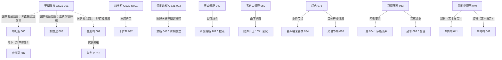

# 《青山》R22｜社会组织包含/经营/隶属关系审核总表

> 本轮遵照用户最新要求，不以双源逐章严格全文PASS作推进门槛，但**不因此将人物自述、同场协作、地理驻地冒充法律隶属**。本轮是R21的108个对象逐个做父关系分流，并向关系图补6个原R21遗漏的关键承接节点；完整关系表含35条有章锚的**分类型关系**，其中不等于35条正式part-of。现有材料不够的父项明确unknown，R23可据本表继续但不得将待证边当定稿。

## 一｜本轮交付数量与证据等级

|核查项|数量|准确含义|
|---|---:|---|
|R21既有对象逐一归类|108/108|每项有标准类型、上位社会范围或父候选及不建立直接父边的原因|
|R22新增承接对象|6|补靖王府/中军都督府/季氏商行/京卫武学/龙江关钞关/备倭军甲乙丙丁四营；仍是候选，不直接改原QS21 ID|
|带章节锚的类型化关系|35|含报告的管辖/经营，实际合作、通讯、票据与否定等，并非纯组织包含数量|
|否定/不应画成part-of的约束|18|避免把旧主树候选结构硬当正式父子|
|世界影响W正式分数|0|R22不改变原W候选值，正式评分留R23|

- `TEXT_REPORTED`：章内人物/行动直接报告的上级、产权或内部组成；已接受为**“文本报告的关系”**，未声称法院、官制文书和全书独立来源已证。
- `OPERATING_RELATION`：文本中有已发生守卫、合作、印刷、分销、执行、场所使用行为；**非行政隶属**。
- `CANDIDATE_OPEN`：部门管辖/产权/身份尚不清楚，只保留关系假说，不进入正式包含边。
- `NEGATIVE_EQUIVALENCE`：同名、同业或共同场景不能合并，也不建包含。
- `DOMAIN_ONLY`：位于宁/景朝治理社会内，不推正式直属皇帝/上级机关。
- `SITE_ONLY`、`COLLECTIVE_ONLY`、`EXCLUDE`：空间、社会群体与超自然战力的**非独立组织**标识。
- 只有具体关系类型`part-of-provisional`/ `operational-subunit-of`/ `faction-of`等的有出处条目才进入该类候选树；`guards`、`prints`、`located-in`、`mediates`永不自动替代`part-of`。

## 二｜补入的六个缺失承接节点（不改R21的108个稳定ID）

|增量ID|对象|候选类型|作者章节|说明|
|---|---|---|---|---|
|QS22-N001|靖王府|宗室府邸/权力组织|40,180,181|R21缺失千岁军上位组织；属于王府政治/侍卫体系，不是全部宁朝军队的军部|
|QS22-N002|中军都督府|军事高层机关|820,826|R20出现该机关与商人请托、解烦卫押解人员；是否直接管理各军营需另证|
|QS22-N003|季氏商行|商号/报业经营候选|821,826,832|姚安委托季家掌柜筹办、刊印《金陵晚报》且刊物已发行；属制作发行关系，季氏商行是否拥有报纸股权/法定产权仍未证|
|QS22-N004|京卫武学|军事教育机构|637|历史R15/R16分片有隶属兵部的直接说明；不能把所有武学都等同该校|
|QS22-N005|龙江关钞关|税务关卡/机构场所候选|752|留都户部监管；具体钞关作为场所或独立收税官署待后续定名|
|QS22-N006|备倭军甲乙丙丁四营|部队内部营级集合|774,775|原材料提及四营组成；不能当作四支独立全国常备军|

## 三｜带来源的35条关系审计清单

|边ID|来源对象ID|目标对象ID|关系类型（不可偷换）|章锚|证据等级|实际依据／必须排除的推断|
|---|---|---|---|---|---|---|
|R22-E001|QS21-006|QS21-007|`administers-or-internal-of`|16,49|`TEXT_REPORTED`|已记录密谍司属司礼监，生肖职能分组存在；**不推**：不推解烦卫必然法定直属密谍司|
|R22-E002|QS21-009|QS21-010|`operational-subunit-of`|17,21|`TEXT_REPORTED`|主刑司鱼龙卫在现场执行行动；**不推**：小队调度不自动代表所有法定编制完备|
|R22-E003|QS22-N001|QS21-032|`armed-guard-of`|40,180|`TEXT_REPORTED`|千岁军作为靖王府护卫出现；**不推**：不是皇帝万岁军|
|R22-E004|QS21-040|QS21-041|`supervises`|738|`TEXT_REPORTED`|景朝枢密院管理军情司的章段记述；**不推**：不能将早期秘密团队完全等于现行法定机关|
|R22-E005|QS21-040|QS21-042|`supervises`|738|`TEXT_REPORTED`|景朝枢密院与军略司管理关联；**不推**：不能以'管理'冒充全体人员直属细目|
|R22-E006|QS21-063|QS21-064|`faction-of`|397,437|`TEXT_REPORTED`|陈家二房属于陈氏宗族内部政治与经济派系；**不推**：不是独立陈氏政权|
|R22-E007|QS21-063|QS21-092|`owns-family-enterprise-candidate`|350,351,558|`TEXT_REPORTED`|陈家盐商总号有掌柜/族中交利和盐号公账；**不推**：陈迹私人粮油铺不归入盐商总号|
|R22-E008|QS21-063|QS21-093|`runs-family-business-candidate`|350|`TEXT_REPORTED`|陈家粮号是陈氏经营分支，名称区别于盐号；**不推**：粮号不是盐号同一个商业主体|
|R22-E009|QS21-049|QS21-102|`operates-site`|433|`TEXT_REPORTED`|黄山道庭有北西南东四城隍庙经营据点；**不推**：四庙非四个独立宗门|
|R22-E010|QS21-050|QS21-103|`operates-site`|130,131|`TEXT_REPORTED`|陆浑山庄为老君山道庭山下别院；**不推**：别院不是与道庭并列的新宗门|
|R22-E011|QS21-048|QS21-107|`has-site`|293,530,839|`OPERATING_RELATION`|武庙以长白山天池山门为修行活动据点；**不推**：位置处景朝不等于武庙受景朝枢密院管辖|
|R22-E012|QS21-073|QS21-084|`operates-service-node-candidate`|407,408,409|`TEXT_REPORTED`|灯火暗号与福来客栈接叶子、跨城转单；**不推**：不同城的同名福来客栈绝不自动合并|
|R22-E013|QS21-073|QS21-086|`reported-owns`|520|`TEXT_REPORTED`|陆氏明确称文昌书局是灯火产业；**不推**：不涵盖全城书局，不作官营财产|
|R22-E014|QS21-073|QS21-098|`operates-ferry-node`|762|`TEXT_REPORTED`|灯火金陵渡船地区正将、票据与船工业务链；**不推**：与外部河道军职不构成同一机构|
|R22-E015|QS21-006|QS21-095|`reported-owns`|550|`TEXT_REPORTED`|金猪称百顺胡同清吟小班为司礼监产业；**不推**：不推广所有清吟小班归司礼监|
|R22-E016|QS21-037|QS22-N006|`unit-formation-of`|774,775|`TEXT_REPORTED`|备倭军甲乙丙丁四营为内部营级编组的叙述；**不推**：不虚构四营的独立全国军政层级|
|R22-E017|QS21-011|QS22-N004|`administers-military-school`|637|`TEXT_REPORTED`|京卫武学归兵部管理的R16旧章节资料；**不推**：不推所有书院受兵部管辖|
|R22-E018|QS21-015|QS22-N005|`regulates-fiscal-site`|752|`TEXT_REPORTED`|留都户部监管龙江关钞关和江南赋税；**不推**：关卡是否独立衙门需再核|
|R22-E019|QS22-N003|QS21-091|`publishing-commission; ownership-open`|821《憑照》,826《鹽引》,832《貪與癡》|`CANDIDATE_OPEN`|821姚安交季家掌柜筹办《金陵晚报》、已有举人与雕版师傅且当日可售；826掌柜称按姚安所嘱刊印并向商贾同行发行，确认委托与制作发行关系。**不推**：季氏商行的法定所有权/股权仍无证，产权父边继续OPEN|
|R22-E020|QS21-086|QS21-089|`prints-and-produces`|512,513|`OPERATING_RELATION`|文昌书局参与京城晨报印刷发行筹办；**不推**：报纸不是同一书局的别名|
|R22-E021|QS21-077|QS21-089|`distributes`|513,515|`OPERATING_RELATION`|梅花渡把棍街巷售《京城晨报》；**不推**：分销不证明梅花渡拥有报纸产权|
|R22-E022|QS21-088|QS21-090|`prints`|764|`OPERATING_RELATION`|琉璃书局参与武襄晨报的印刷；**不推**：发行牌照/法人产权待证|
|R22-E023|QS21-041|QS21-080|`funded-by-business-front`|31,33,66|`TEXT_REPORTED`|景朝军情司司曹述百鹿阁筹资与掩护；**不推**：不标百鹿阁为军情司正式官署|
|R22-E024|QS21-031|QS21-100|`guards`|410,411|`OPERATING_RELATION`|万岁军守京仓；**不推**：场所不是军队下级机构|
|R22-E025|QS21-045|QS21-052|`battlefield-cooperation`|275|`OPERATING_RELATION`|天策军与苦觉寺僧兵在战事协同；**不推**：双方行政/宗教所属不变|
|R22-E026|QS21-074|QS21-075|`mediates-with`|548|`OPERATING_RELATION`|三山会祁公居中传话及与韩童斡旋；**不推**：调停并非三山会吞并漕帮|
|R22-E027|QS21-016|QS21-017|`joint-enforcement`|559|`OPERATING_RELATION`|都察院巡按御史凭驾帖调五城兵马司查封梅花渡；**不推**：一次协同执法非永久监察直属关系|
|R22-E028|QS21-007|QS21-008|`parallel-warrants`|406,407|`OPERATING_RELATION`|白龙密谍司与林朝青解烦卫各发不同海捕文书；**不推**：两者不同机构，不合并也不互判法定上级|
|R22-E029|QS21-073|QS21-083|`shared-secret-contact-network`|247《真正的密道》,作者407《灯火客栈》|`CANDIDATE_OPEN`|WebNovel目录平台槽408自标作者题名407《灯火客栈》（https://www.webnovel.com/book/22444590709113204/catalog）；正文中陈迹称自己替固原龙门客栈掌柜收尸，灯火客栈以暗号筛选托办事项，掌柜称帷帽女子为“东家”并向其报告（TTkan：https://ttks.tw/novel/chapters/qingshan/579.html；顶点：https://www.dingdian888.com/zhangjie/733514/709781299.html）。支持灯火与固原龙门掌柜之间存在联络/信息通道线索；收尸为陈迹陈述，且未证明固原龙门客栈产权或正式归属灯火，E029继续OPEN|
|R22-E030|QS21-041|QS21-097|`suspected-intelligence-contact`|作者页题名《截胡》《砍他》（转载编号不作为章号依据）|`CANDIDATE_OPEN`|248《截胡》客栈伙计称景朝商队在红袖招交换情报；249《砍他》所谓线人密报被揭为齐斟酌虚报，现场血迹/刀痕/断指未明凶手和归属。仅存传闻及调查线索；不证实实际谍报活动、产权、管理或军情司指挥隶属|
|R22-E031|QS21-075|QS21-076|`temporary-military-cooperation`|786,792|`OPERATING_RELATION`|漕帮与盐帮战时协防线索；**不推**：漕帮不属于盐帮，反之亦然|
|R22-E032|QS21-049|QS21-104|`site-governance-candidate`|818《落脚》,840《无人试剑》|`CANDIDATE_OPEN`|818《落脚》：黄山道庭上尊法旨到达朝天宫现场；张宁传达追杀青牛命令，并命弟子封山门、召八大总商、在普天大醮前收回散落的万神临舍（https://ixdzs.tw/read/549077/p822.html）。这是有现场执行动作的道庭指令线索，不证明朝天宫常设归属、产权或完整治理权。840《无人试剑》可证黄山道庭主办普天大醮并由门人执行法坛仪式（https://ixdzs.tw/read/549077/p844.html）；该页不证明仪式地点就是朝天宫，故不将其当作E032的场所管辖证据。**不推**：仍无产权、长期管理或法定直属记录；E032保持OPEN。|
|R22-E033|QS21-014|QS21-015|`regional-fiscal-counterpart; remit-differentiated`|作者752《隐入市井》|`CANDIDATE_OPEN`|正文称龙江关为户部钞关、宁朝水路征税大关；留都户部尚书庄桉命税吏查船征税，且明确留都户部“只管南直隶漕粮、龙江关关税、江南财赋，权力小得多”。这证实地方财政职责范围与户部体系同类但有区域分工；**不推**：未证明留都户部对中央户部的法定隶属/指挥，也未证明中央户部对其完整控制|
|R22-E034|QS21-071|QS21-038|`influences-private-guard-candidate`|112,113|`CANDIDATE_OPEN`|刘氏能调动象甲卫、具兵员行动；**不推**：合法武装产权与实际隶属待证|
|R22-E035|QS21-089|QS21-091|`different-publication`|513,821|`NEGATIVE_EQUIVALENCE`|京城晨报与金陵晚报属于不同报业项目；**不推**：不能以'晨报'/'晚报'共有字眼合并|

**其中关系级别数量**：`TEXT_REPORTED` 18；`OPERATING_RELATION` 10；`CANDIDATE_OPEN` 6；`NEGATIVE_EQUIVALENCE` 1。此表不能以关系数当作已确认正式上下级边数。

## 四｜R21原108个对象：逐个判断其主要社会父关系

- 表中“主要父／关联”仅为**本轮优先核查的社会关系对象**；`within-polity`并非任免层级；`printed-by`、`guarded-by`方向仅便于索引，别据“主要父”字段生成错误part-of图。
- 状态类型数：`ACCEPTED_CLASS` 5；`DOMAIN_ONLY` 32；`TEXT_REPORTED` 15；`OPEN` 4；`COLLECTIVE_ONLY` 3；`UNKNOWN_PARENT` 11；`CLASSIFIED` 30；`OPERATING_RELATION` 5；`SITE_ONLY` 2；`EXCLUDE` 1。
- **没有填关系**的独立社会势力，不是系统遗漏，而是“现阶段没有上级机构证据”；它们可以是世界结构第一层的独立共同体。

|对象ID|名称|原R21类型|候选主关联对象|关系类型|当前等级|判断及反例|
|---|---|---|---|---|---|---|
|QS21-001|宁朝|ENTITY|无已证父项|`polity-root`|`ACCEPTED_CLASS`|政权上位分类，单独计社会系统|
|QS21-002|景朝|ENTITY|无已证父项|`polity-root`|`ACCEPTED_CLASS`|政权上位分类，单独计社会系统|
|QS21-003|高丽|ENTITY|无已证父项|`independent-polity`|`ACCEPTED_CLASS`|其他政权，不是宁朝/景朝子机构|
|QS21-004|安南|ENTITY|无已证父项|`independent-polity`|`ACCEPTED_CLASS`|其他政权，不是宁朝/景朝子机构|
|QS21-005|倭国|ENTITY|无已证父项|`independent-polity`|`ACCEPTED_CLASS`|其他政权，不是宁朝/景朝子机构|
|QS21-006|宁朝司礼监|ENTITY|QS21-001|`within-polity`|`DOMAIN_ONLY`|政权范围/社会组成关系，不表示宁帝或朝廷正式直属，仍需具体官制边|
|QS21-007|密谍司|ENTITY|QS21-006|`part-of-provisional`|`TEXT_REPORTED`|第16章记录称密谍司属司礼监麾下，正式公文未取得；不把解烦卫顺带挂进去|
|QS21-008|解烦卫|ENTITY|QS21-001|`within-polity`|`DOMAIN_ONLY`|政权范围/社会组成关系，不表示宁帝或朝廷正式直属，仍需具体官制边|
|QS21-009|主刑司|ENTITY|QS21-001|`within-polity`|`DOMAIN_ONLY`|政权范围/社会组成关系，不表示宁帝或朝廷正式直属，仍需具体官制边|
|QS21-010|鱼龙卫|SUBUNIT|QS21-009|`operational-subunit-of`|`TEXT_REPORTED`|17/21主刑司鱼龙卫参与行动；机构与组员分开|
|QS21-011|兵部|ENTITY|QS21-001|`within-polity`|`DOMAIN_ONLY`|政权范围/社会组成关系，不表示宁帝或朝廷正式直属，仍需具体官制边|
|QS21-012|吏部|ENTITY|QS21-001|`within-polity`|`DOMAIN_ONLY`|政权范围/社会组成关系，不表示宁帝或朝廷正式直属，仍需具体官制边|
|QS21-013|礼部|ENTITY|QS21-001|`within-polity`|`DOMAIN_ONLY`|政权范围/社会组成关系，不表示宁帝或朝廷正式直属，仍需具体官制边|
|QS21-014|户部|ENTITY|QS21-001|`within-polity`|`DOMAIN_ONLY`|政权范围/社会组成关系，不表示宁帝或朝廷正式直属，仍需具体官制边|
|QS21-015|留都户部|SUBUNIT|QS21-014|`regional-fiscal-branch-candidate`|`OPEN`|留都户部与户部功能同系但具体制度隶属、地方权限边界尚未闭合|
|QS21-016|都察院|ENTITY|QS21-001|`within-polity`|`DOMAIN_ONLY`|政权范围/社会组成关系，不表示宁帝或朝廷正式直属，仍需具体官制边|
|QS21-017|五城兵马司|ENTITY|QS21-001|`within-polity`|`DOMAIN_ONLY`|政权范围/社会组成关系，不表示宁帝或朝廷正式直属，仍需具体官制边|
|QS21-018|洛城兵马司|ENTITY|QS21-001|`within-polity`|`DOMAIN_ONLY`|政权范围/社会组成关系，不表示宁帝或朝廷正式直属，仍需具体官制边|
|QS21-019|鸿胪寺|ENTITY|QS21-001|`within-polity`|`DOMAIN_ONLY`|政权范围/社会组成关系，不表示宁帝或朝廷正式直属，仍需具体官制边|
|QS21-020|钦天监|ENTITY|QS21-001|`within-polity`|`DOMAIN_ONLY`|政权范围/社会组成关系，不表示宁帝或朝廷正式直属，仍需具体官制边|
|QS21-021|太医院|ENTITY|QS21-001|`within-polity`|`DOMAIN_ONLY`|政权范围/社会组成关系，不表示宁帝或朝廷正式直属，仍需具体官制边|
|QS21-022|尚衣监|ENTITY|QS21-001|`within-polity`|`DOMAIN_ONLY`|政权范围/社会组成关系，不表示宁帝或朝廷正式直属，仍需具体官制边|
|QS21-023|宝钞司|ENTITY|QS21-001|`within-polity`|`DOMAIN_ONLY`|政权范围/社会组成关系，不表示宁帝或朝廷正式直属，仍需具体官制边|
|QS21-024|鹰房司|ENTITY|QS21-001|`within-polity`|`DOMAIN_ONLY`|政权范围/社会组成关系，不表示宁帝或朝廷正式直属，仍需具体官制边|
|QS21-025|御用司|ENTITY|QS21-001|`within-polity`|`DOMAIN_ONLY`|政权范围/社会组成关系，不表示宁帝或朝廷正式直属，仍需具体官制边|
|QS21-026|国子监|ENTITY|QS21-001|`within-polity`|`DOMAIN_ONLY`|政权范围/社会组成关系，不表示宁帝或朝廷正式直属，仍需具体官制边|
|QS21-027|匠作监|ENTITY|QS21-001|`within-polity`|`DOMAIN_ONLY`|政权范围/社会组成关系，不表示宁帝或朝廷正式直属，仍需具体官制边|
|QS21-028|柴碳局|ENTITY|QS21-001|`within-polity`|`DOMAIN_ONLY`|政权范围/社会组成关系，不表示宁帝或朝廷正式直属，仍需具体官制边|
|QS21-029|都司府|ENTITY|QS21-001|`within-polity`|`DOMAIN_ONLY`|政权范围/社会组成关系，不表示宁帝或朝廷正式直属，仍需具体官制边|
|QS21-030|羽林军|ENTITY|QS21-001|`within-polity`|`DOMAIN_ONLY`|政权范围/社会组成关系，不表示宁帝或朝廷正式直属，仍需具体官制边|
|QS21-031|万岁军|ENTITY|QS21-001|`within-polity`|`DOMAIN_ONLY`|政权范围/社会组成关系，不表示宁帝或朝廷正式直属，仍需具体官制边|
|QS21-032|千岁军|ENTITY|QS22-N001|`armed-guard-of`|`TEXT_REPORTED`|40章千岁军是靖王府护卫；与万岁军不等同|
|QS21-033|五军营|ENTITY|QS21-001|`within-polity`|`DOMAIN_ONLY`|政权范围/社会组成关系，不表示宁帝或朝廷正式直属，仍需具体官制边|
|QS21-034|神机营|ENTITY|QS21-001|`within-polity`|`DOMAIN_ONLY`|政权范围/社会组成关系，不表示宁帝或朝廷正式直属，仍需具体官制边|
|QS21-035|边军|COLLECTIVE|QS21-001|`within-polity`|`DOMAIN_ONLY`|政权范围/社会组成关系，不表示宁帝或朝廷正式直属，仍需具体官制边|
|QS21-036|夜不收|COLLECTIVE|QS21-035|`role-within-various-armies`|`COLLECTIVE_ONLY`|夜不收是不同边镇军队的斥候角色集合，不是全国单一官署|
|QS21-037|备倭军|ENTITY|QS21-001|`within-polity`|`DOMAIN_ONLY`|政权范围/社会组成关系，不表示宁帝或朝廷正式直属，仍需具体官制边|
|QS21-038|象甲卫|ENTITY|QS21-071|`political-influence-candidate`|`OPEN`|刘氏与象甲卫调兵联系，无法证明独占所有权或合法编制|
|QS21-039|虎甲铁骑|ENTITY|QS21-001|`within-polity`|`DOMAIN_ONLY`|政权范围/社会组成关系，不表示宁帝或朝廷正式直属，仍需具体官制边|
|QS21-040|景朝枢密院|ENTITY|QS21-002|`within-polity`|`DOMAIN_ONLY`|景朝政军社会范畴，并非法定直接下级；具体母机构须另证|
|QS21-041|景朝军情司|ENTITY|QS21-040|`supervised-by`|`TEXT_REPORTED`|738章枢密院监管军情司，旧章提其早期未获批不推翻现阶段监管|
|QS21-042|景朝军略司|ENTITY|QS21-040|`supervised-by`|`TEXT_REPORTED`|738章枢密院监管军略司；监管≠已证完全法定包含|
|QS21-043|景朝虎贲军|ENTITY|QS21-002|`within-polity`|`DOMAIN_ONLY`|景朝政军社会范畴，并非法定直接下级；具体母机构须另证|
|QS21-044|景朝虎豹骑|ENTITY|QS21-002|`within-polity`|`DOMAIN_ONLY`|景朝政军社会范畴，并非法定直接下级；具体母机构须另证|
|QS21-045|景朝天策军|ENTITY|QS21-002|`within-polity`|`DOMAIN_ONLY`|景朝政军社会范畴，并非法定直接下级；具体母机构须另证|
|QS21-046|捉生将|COLLECTIVE|QS21-002|`field-role-within-polity`|`COLLECTIVE_ONLY`|捉生将是景朝边镇作战人员群体，不等于军情司的新部门|
|QS21-047|松浦氏海上武装|ENTITY|无已证父项|`independent-or-irregular-force`|`UNKNOWN_PARENT`|松浦氏海上武装未证倭国政府法定指挥，保持独立海上势力候选|
|QS21-048|武庙|ENTITY|无已证父项|`independent-organization`|`CLASSIFIED`|修行/宗教/教育机构存在，尚无证据的行政直属不得硬画|
|QS21-049|黄山道庭|ENTITY|无已证父项|`independent-organization`|`CLASSIFIED`|修行/宗教/教育机构存在，尚无证据的行政直属不得硬画|
|QS21-050|老君山道庭|ENTITY|无已证父项|`independent-organization`|`CLASSIFIED`|修行/宗教/教育机构存在，尚无证据的行政直属不得硬画|
|QS21-051|缘觉寺|ENTITY|无已证父项|`independent-organization`|`CLASSIFIED`|修行/宗教/教育机构存在，尚无证据的行政直属不得硬画|
|QS21-052|苦觉寺|ENTITY|无已证父项|`independent-organization`|`CLASSIFIED`|修行/宗教/教育机构存在，尚无证据的行政直属不得硬画|
|QS21-053|陀罗寺|ENTITY|无已证父项|`independent-organization`|`CLASSIFIED`|修行/宗教/教育机构存在，尚无证据的行政直属不得硬画|
|QS21-054|广济寺|ENTITY|无已证父项|`independent-organization`|`CLASSIFIED`|修行/宗教/教育机构存在，尚无证据的行政直属不得硬画|
|QS21-055|大昭寺|ENTITY|无已证父项|`independent-organization`|`CLASSIFIED`|修行/宗教/教育机构存在，尚无证据的行政直属不得硬画|
|QS21-056|罗天宗|ENTITY|无已证父项|`independent-organization`|`CLASSIFIED`|修行/宗教/教育机构存在，尚无证据的行政直属不得硬画|
|QS21-057|青衣宗|ENTITY|无已证父项|`independent-organization`|`CLASSIFIED`|修行/宗教/教育机构存在，尚无证据的行政直属不得硬画|
|QS21-058|葛宁派|ENTITY|无已证父项|`independent-organization`|`CLASSIFIED`|修行/宗教/教育机构存在，尚无证据的行政直属不得硬画|
|QS21-059|知行书院|ENTITY|无已证父项|`independent-organization`|`CLASSIFIED`|修行/宗教/教育机构存在，尚无证据的行政直属不得硬画|
|QS21-060|东林书院|ENTITY|无已证父项|`independent-organization`|`CLASSIFIED`|修行/宗教/教育机构存在，尚无证据的行政直属不得硬画|
|QS21-061|青崖书院|ENTITY|无已证父项|`independent-organization`|`CLASSIFIED`|修行/宗教/教育机构存在，尚无证据的行政直属不得硬画|
|QS21-062|岳麓书院|ENTITY|无已证父项|`independent-organization`|`CLASSIFIED`|修行/宗教/教育机构存在，尚无证据的行政直属不得硬画|
|QS21-063|京城陈家|ENTITY|无已证父项|`independent-kinship-network`|`CLASSIFIED`|宗族身份/家系；不因其成员做官推官署为家产|
|QS21-064|陈家二房|SUBUNIT|QS21-063|`faction-of`|`TEXT_REPORTED`|陈家二房为陈氏内部派系，非第二家同姓政权|
|QS21-065|洛城同知陈府|HOMONYM_SPLIT|无已证父项|`independent-kinship-network`|`CLASSIFIED`|宗族身份/家系；不因其成员做官推官署为家产|
|QS21-066|齐家|ENTITY|无已证父项|`independent-kinship-network`|`CLASSIFIED`|宗族身份/家系；不因其成员做官推官署为家产|
|QS21-067|徐家|ENTITY|无已证父项|`independent-kinship-network`|`CLASSIFIED`|宗族身份/家系；不因其成员做官推官署为家产|
|QS21-068|张家|ENTITY|无已证父项|`independent-kinship-network`|`CLASSIFIED`|宗族身份/家系；不因其成员做官推官署为家产|
|QS21-069|胡家|ENTITY|无已证父项|`independent-kinship-network`|`CLASSIFIED`|宗族身份/家系；不因其成员做官推官署为家产|
|QS21-070|羊家|ENTITY|无已证父项|`independent-kinship-network`|`CLASSIFIED`|宗族身份/家系；不因其成员做官推官署为家产|
|QS21-071|刘家|ENTITY|无已证父项|`independent-kinship-network`|`CLASSIFIED`|宗族身份/家系；不因其成员做官推官署为家产|
|QS21-072|景朝陆氏家族|ENTITY|无已证父项|`independent-kinship-network`|`CLASSIFIED`|宗族身份/家系；不因其成员做官推官署为家产|
|QS21-073|灯火|ENTITY|无已证父项|`independent-private-network`|`CLASSIFIED`|民间组织或联合体；不因合作推正式父关系|
|QS21-074|三山会|ENTITY|无已证父项|`independent-private-network`|`CLASSIFIED`|民间组织或联合体；不因合作推正式父关系|
|QS21-075|漕帮|ENTITY|无已证父项|`independent-private-network`|`CLASSIFIED`|民间组织或联合体；不因合作推正式父关系|
|QS21-076|盐帮|ENTITY|无已证父项|`independent-private-network`|`CLASSIFIED`|民间组织或联合体；不因合作推正式父关系|
|QS21-077|梅花渡|ENTITY|无已证父项|`independent-private-network`|`CLASSIFIED`|民间组织或联合体；不因合作推正式父关系|
|QS21-078|武盟|ENTITY|无已证父项|`independent-private-network`|`CLASSIFIED`|民间组织或联合体；不因合作推正式父关系|
|QS21-079|八大总商|COLLECTIVE|无已证父项|`coalition-not-single-office`|`COLLECTIVE_ONLY`|八大总商是盐商联合利益群体，未证国家官署|
|QS21-080|百鹿阁|ENTITY|QS21-041|`funding-front-candidate`|`TEXT_REPORTED`|31–33章百鹿阁司曹自述为军情司供给经费，经济/掩护关系非正式分司|
|QS21-081|朝仓赌坊|ENTITY|无已证父项|`business-or-service-entity`|`UNKNOWN_PARENT`|商号/商业服务节点/出版产品；产权经营关系需逐条看明示证据|
|QS21-082|太平医馆|ENTITY|无已证父项|`business-or-service-entity`|`UNKNOWN_PARENT`|商号/商业服务节点/出版产品；产权经营关系需逐条看明示证据|
|QS21-083|固原龙门客栈|ENTITY|无已证父项|`business-or-service-entity`|`UNKNOWN_PARENT`|作者407《灯火客栈》新增暗号/掌柜报告线索；可支持联络通道候选，产权及正式归属仍无明示证据|
|QS21-084|昌平福来客栈|ALIAS_MERGED|QS21-073|`operated-service-node-candidate`|`TEXT_REPORTED`|407–408灯火暗语和昌平福来客栈接叶子/跨城转单，经营节点关系|
|QS21-085|洛城福来客栈|HOMONYM_SPLIT|无已证父项|`business-or-service-entity`|`UNKNOWN_PARENT`|商号/商业服务节点/出版产品；产权经营关系需逐条看明示证据|
|QS21-086|文昌书局|ENTITY|QS21-073|`reported-owned-enterprise`|`TEXT_REPORTED`|520章陆氏明确称文昌书局属灯火产业；合同产权未见|
|QS21-087|文远书局|ENTITY|无已证父项|`business-or-service-entity`|`UNKNOWN_PARENT`|商号/商业服务节点/出版产品；产权经营关系需逐条看明示证据|
|QS21-088|琉璃书局|ENTITY|无已证父项|`independent-publishing-business`|`UNKNOWN_PARENT`|琉璃书局与《武襄晨报》排印有关，未取得直接产权关系|
|QS21-089|京城晨报|ENTITY|QS21-086|`printed-by`|`OPERATING_RELATION`|512–513文昌书局与报纸制作可见；报纸为出版产品而非书局同义ID|
|QS21-090|武襄晨报|ENTITY|QS21-088|`printed-by`|`OPERATING_RELATION`|764章琉璃书局参与《武襄晨报》排印；报纸与书局不是一个对象|
|QS21-091|金陵晚报|ENTITY|QS22-N003|`commissioned-publication-candidate`|`OPEN`|821季家掌柜受姚安指示筹办金陵晚报；商行法律持有仍未证|
|QS21-092|陈家盐商总号|ENTITY|QS21-063|`family-owned-enterprise`|`TEXT_REPORTED`|350、558陈家盐号掌柜与宗族公账，家财联系直接但账面具体所有权仍应细分|
|QS21-093|陈家粮号|ENTITY|QS21-063|`family-business-candidate`|`TEXT_REPORTED`|350陈家盐号另提陈家粮号；同姓宗族经营，不合并两商号|
|QS21-094|陈迹个人粮油铺|ENTITY|无已证父项|`business-or-service-entity`|`UNKNOWN_PARENT`|商号/商业服务节点/出版产品；产权经营关系需逐条看明示证据|
|QS21-095|清吟小班（百顺胡同）|ENTITY|QS21-006|`reported-owned-enterprise`|`TEXT_REPORTED`|550金猪明确称百顺胡同清吟小班属司礼监产业，正式产权资料未核|
|QS21-096|洛城白衣巷清吟小班|HOMONYM_SPLIT|无已证父项|`business-or-service-entity`|`UNKNOWN_PARENT`|商号/商业服务节点/出版产品；产权经营关系需逐条看明示证据|
|QS21-097|红袖招|ENTITY|无已证父项|`business-or-service-entity`|`UNKNOWN_PARENT`|商号/商业服务节点/出版产品；产权经营关系需逐条看明示证据|
|QS21-098|金陵渡船灯火节点|SUBUNIT|QS21-073|`operated-transport-node`|`TEXT_REPORTED`|762灯火金陵渡船、地区正将、竹票与船工调度链|
|QS21-099|盐引交易所|SITE|无已证父项|`business-or-service-entity`|`UNKNOWN_PARENT`|商号/商业服务节点/出版产品；产权经营关系需逐条看明示证据|
|QS21-100|京仓|SITE|QS21-031|`guarded-by`|`OPERATING_RELATION`|410/411万岁军驻守京仓，仅护卫不为组织包含|
|QS21-101|文胆堂|SITE|QS21-063|`used-by-family`|`OPERATING_RELATION`|430陈家文胆堂是宗族议事场所|
|QS21-102|黄山四城隍庙|SITE|QS21-049|`operated-religious-sites`|`TEXT_REPORTED`|433黄山道庭在京畿四城隍庙经营信众，非四家独立道庭|
|QS21-103|陆浑山庄|SITE|QS21-050|`religious-outpost-of`|`TEXT_REPORTED`|130老君山道庭山下别院陆浑山庄|
|QS21-104|朝天宫|SITE|QS21-049|`site-governance-candidate`|`OPEN`|818证实现场法旨与任务执行；840证实道庭仪式但未定位为朝天宫；产权、长期管辖与法定直属仍不宜硬判|
|QS21-105|会同馆|SITE|无已证父项|`site-not-independent-org`|`SITE_ONLY`|作为场所记录；不会作为独立组织计数|
|QS21-106|贡院|SITE|无已证父项|`site-not-independent-org`|`SITE_ONLY`|作为场所记录；不会作为独立组织计数|
|QS21-107|武庙长白山天池山门|SITE|QS21-048|`mountain-base-of`|`OPERATING_RELATION`|293/530/839武庙山门及长白山天池地理与门人据点关系|
|QS21-108|五猖兵马|EXCLUDE|无已证父项|`excluded-supernatural`|`EXCLUDE`|术法召唤战力，非人间常驻社会组织|

## 五｜18条禁止误画的父子关系与同体判断

|误判对象A|误判对象B|应有判断|章节|否定理由|
|---|---|---|---|---|
|武庙|景朝枢密院或景朝政权|不建立part-of|61,293,839|武庙长白山据点在景朝境内，地理不等于官署下属；武庙有独立山长|
|五军营／东宫近侍|万岁军|不建立part-of|392,394|392/394羊羊临时战术指挥，并非万岁军长期统辖另两军|
|京仓|万岁军|不建立part-of|410,411|410/411是万岁军守卫仓廒，不是仓廒变为军伍内部部队|
|解烦卫|密谍司|不建立已证part-of|406,407|两方独立发海捕文书，具体法定上级仍留空|
|主刑司|密谍司|不建立已证part-of|17,19|监察、现场互相制衡不是内部官署包含关系|
|千岁军|万岁军|不同实体|40,180|靖王府的王府军与宁帝万岁军不同|
|虎豹骑|武庙|不建立part-of|476,478|元亨利贞的武庙师承属于个人履历|
|苦觉寺僧兵|景朝天策军|不建立part-of|275|战场协作不构成寺门全部改隶景朝军制|
|三山会|漕帮|不建立part-of|548|祁公调停韩童，社会中人关系是横向|
|灯火|宁朝边军|不建立part-of|408|运军粮、照顾军属为商运与互助关系|
|文昌书局|京城晨报|不得same-as|512,513|书局是印刷经营单位，报纸是产品/经营品牌|
|文远书局|文昌书局|不同主体|532,535|市场竞争、不同经营者与书局名称|
|洛城福来客栈|昌平福来客栈|不同节点|82,407|不同城市、无共同产权|
|洛城白衣巷清吟小班|百顺胡同清吟小班|不同节点|69,550|一个洛城一个京城，不能因同业同名归司礼监|
|陈迹个人粮油铺|陈家盐商总号|不得same-as|509,558|509不同授权与账簿，558家族盐号公账不同资产|
|漕帮|宁朝漕运卫所|未发生part-of|555|555内相授官改造为计划，尚无全部人员授职执行|
|五猖兵马|宁/景正式军制|排除|393,399|393/399召唤战力，古时百夫长/什长军语不等于当前现世编制|
|黄山四城隍庙|四个独立黄山道庭|不得计4新宗门|433|433是黄山道庭四处宗教经营场所|

## 六｜可用于阅读的结构关系示意（实有机构 / 场所 / 经济网络分开）

此图展示的是**有类型的关系网络**，不是把国家、宗族、寺观、商号强行拼成“一条永远严格父子关系树”。

## 七｜入库及下一阶段

- 输入正本：
- [QS_334_R21_跨20轮组织去重主表_20261115.md](https://github.com/lukunanaron674-stack/-ten-yuan-vault/blob/main/09-%E7%BB%99674%EF%BC%88%E6%88%91%EF%BC%89%E7%94%A8%E7%9A%84%E5%BA%93/%E6%A6%82%E5%BF%B5%E5%BA%93/%E7%8E%AF%E5%A2%83%E6%A6%82%E5%BF%B5%E8%AE%BE%E8%AE%A1%E6%80%BB%E5%BA%93/06_%E7%A4%BE%E4%BC%9A%E7%BB%93%E6%9E%84/%E9%9D%92%E5%B1%B1_%E7%BB%84%E7%BB%87%E9%87%87%E9%9B%86%E5%88%86%E7%89%87/QS_334_R21_%E8%B7%A820%E8%BD%AE%E7%BB%84%E7%BB%87%E5%8E%BB%E9%87%8D%E4%B8%BB%E8%A1%A8_20261115.md)
- [QS_334_R10-R13_跨章去重与世界影响候选_20261115.md](https://github.com/lukunanaron674-stack/-ten-yuan-vault/blob/main/09-%E7%BB%99674%EF%BC%88%E6%88%91%EF%BC%89%E7%94%A8%E7%9A%84%E5%BA%93/%E6%A6%82%E5%BF%B5%E5%BA%93/%E7%8E%AF%E5%A2%83%E6%A6%82%E5%BF%B5%E8%AE%BE%E8%AE%A1%E6%80%BB%E5%BA%93/06_%E7%A4%BE%E4%BC%9A%E7%BB%93%E6%9E%84/%E9%9D%92%E5%B1%B1_%E7%BB%84%E7%BB%87%E9%87%87%E9%9B%86%E5%88%86%E7%89%87/QS_334_R10-R13_%E8%B7%A8%E7%AB%A0%E5%8E%BB%E9%87%8D%E4%B8%8E%E4%B8%96%E7%95%8C%E5%BD%B1%E5%93%8D%E5%80%99%E9%80%89_20261115.md)
- [QS_334_R14-R18_本轮收口账及章号校正_20261115.md](https://github.com/lukunanaron674-stack/-ten-yuan-vault/blob/main/09-%E7%BB%99674%EF%BC%88%E6%88%91%EF%BC%89%E7%94%A8%E7%9A%84%E5%BA%93/%E6%A6%82%E5%BF%B5%E5%BA%93/%E7%8E%AF%E5%A2%83%E6%A6%82%E5%BF%B5%E8%AE%BE%E8%AE%A1%E6%80%BB%E5%BA%93/06_%E7%A4%BE%E4%BC%9A%E7%BB%93%E6%9E%84/%E9%9D%92%E5%B1%B1_%E7%BB%84%E7%BB%87%E9%87%87%E9%9B%86%E5%88%86%E7%89%87/QS_334_R14-R18_%E6%9C%AC%E8%BD%AE%E6%94%B6%E5%8F%A3%E8%B4%A6%E5%8F%8A%E7%AB%A0%E5%8F%B7%E6%A0%A1%E6%AD%A3_20261115.md)
- [QS_R19_作者775-817_分章核证_STAGING_20261115.md](https://github.com/lukunanaron674-stack/-ten-yuan-vault/blob/main/09-%E7%BB%99674%EF%BC%88%E6%88%91%EF%BC%89%E7%94%A8%E7%9A%84%E5%BA%93/%E6%A6%82%E5%BF%B5%E5%BA%93/%E7%8E%AF%E5%A2%83%E6%A6%82%E5%BF%B5%E8%AE%BE%E8%AE%A1%E6%80%BB%E5%BA%93/06_%E7%A4%BE%E4%BC%9A%E7%BB%93%E6%9E%84/%E9%9D%92%E5%B1%B1_%E7%BB%84%E7%BB%87%E9%87%87%E9%9B%86%E5%88%86%E7%89%87/QS_R19_%E4%BD%9C%E8%80%85775-817_%E5%88%86%E7%AB%A0%E6%A0%B8%E8%AF%81_STAGING_20261115.md)
- [QS_R20_作者818-860_分章核证_STAGING_20261115.md](https://github.com/lukunanaron674-stack/-ten-yuan-vault/blob/main/09-%E7%BB%99674%EF%BC%88%E6%88%91%EF%BC%89%E7%94%A8%E7%9A%84%E5%BA%93/%E6%A6%82%E5%BF%B5%E5%BA%93/%E7%8E%AF%E5%A2%83%E6%A6%82%E5%BF%B5%E8%AE%BE%E8%AE%A1%E6%80%BB%E5%BA%93/06_%E7%A4%BE%E4%BC%9A%E7%BB%93%E6%9E%84/%E9%9D%92%E5%B1%B1_%E7%BB%84%E7%BB%87%E9%87%87%E9%9B%86%E5%88%86%E7%89%87/QS_R20_%E4%BD%9C%E8%80%85818-860_%E5%88%86%E7%AB%A0%E6%A0%B8%E8%AF%81_STAGING_20261115.md)
- 可靠性遗留：R17原缺正文作者706、710、718、726，R18原733、742；R20作者857–860只有章题，不能据其建新关系。R08/R09部分材料未覆盖全窗。因此本轮“108/108对象分类”不应误读成所有实际存在组织已被找到。
- R22总体状态：`RELATION_CLASSIFICATION_COMPLETE_PARENT_OPEN`。按取消严格双源门槛的新规则可**进入R23**，但正式法定直属与商业产权不再假装无缺口。
- R23须依据社会覆盖、持续制度影响、经济资源配置、跨组织约束和长期存在性给**各个真实独立组织**W候选评分；子单位、场所、岗位、集合类别单列或不排序。没有支持的项保持W?。原主树的旧候选分不当成新验证分数。

## R24增量核证｜R22-E030红袖招证据边界｜2026-11-15

248《截胡》：客栈伙计小五称红袖招是景朝商队歇脚并交换情报之处（单站人物陈述）；同章称龙门客栈用地板下听瓮监听客谈话、暗记打听边军军情者。249《砍他》：齐斟酌声称收到线人密报、称红袖招为景朝谍子据点；正文随即显示李玄知道齐并未安插线人，齐后又承认实际消息来自陈迹。羽林军赶到时红袖招无人，现场有血迹、刀痕、断指；李玄判断发生杀戮，但死者身份、凶手和行动归属未明。故现有材料只支持单站说法/伪报/现场调查线索，不证明红袖招是实际景朝军情司据点，也不证明其产权、常设管理或指挥隶属。

证据来源：作者页题名248《截胡》https://czbooks.net/n/s6ojkc/s6on1m8k?chapterNumber=252（第81–110行）；作者页题名249《砍他》https://czbooks.net/n/s6ojkc/s6oni91h?chapterNumber=253（第103–160行）；独立转载的《砍他》页题名交叉 https://www.webnovel.com/book/22444590709113204/85580804905821202（平台标题“Chapter 249: 248、砍他”，正文锁章，只作题名交叉，不作完整证据）。

结论：R22-E030继续 `CANDIDATE_OPEN`，不改为 `part-of`、直属或产权边；QS21-097原W170/L不变；114对象、35条关系、6条OPEN均不变。