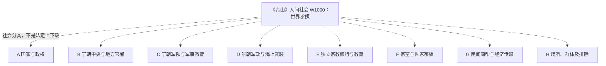
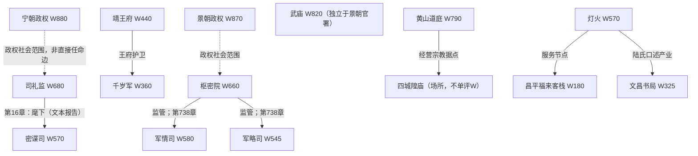

> **2026-11-17跨文件计数/来源指针对齐**：远端R22关系图为40条正向类型关系+1条反同体；R24 Canvas为128节点/49边（40条关系+8条社会分类+1条文件索引）；R24 JSON为114对象/41条关系记录，状态计数20/14/6/1；当前6条`CANDIDATE_OPEN`为E019、E030、E032、E033、E034、E039，E029已为`TEXT_REPORTED`。作者290《后会有期》补入QS21-083与E039：存在隐名东家/掌柜任命权限线索，但东家身份及产权仍OPEN。R22-E040记录中军都督府对备倭军军功核验/监军职责的文本报告；E041记录作者517藏头消息经《京城晨报》传递，作者519补充该渠道曾被试探可靠性、随后静默等待再次启用（仅搜索摘要）；E036新增作者846–847正文、848搜索摘要后升级为漕帮成员团队实际印刷/发行`OPERATING_RELATION`。E019仍OPEN；作者832《贪与痴》正文补充季氏掌柜被姚安点明为司曹壬、并报告各家向胡家寻求襄助；该章未直接提及《金陵晚报》，仅作人物联络/回报角色背景，不作产权证据。W610、漕帮W590、金陵晚报W330均不变。R21、R22、R23与R01–R20索引指针已同步当前GitHub blob；旧评论中的轮次计数保留为历史快照。
# 《青山》全组织采集与世界体量树｜R24最终整合阅读版

> **你要求的是影响《青山》整个世界社会运作的体量，不是建筑物面积、组织人数、单次战力或读者心中份量。** 本文为第24轮已经交付的**全阶段汇总版本**，承接R01–R20资料、R21去重、R22包含关系审核及R23评分。**未宣称所有章节均取得正文或全书一切组织绝对穷尽**，缺源和开放产权均如实保留。

## 00｜最终验收口径与完成判据

|审计对象|R24实检结果|验收判定|
|---|---|---|
|R01–R20轮次|20个窗口均有材料索引；历史859章快照，当前整理至作者860章|**索引收口**，不等于每章全文已读|
|R21跨章对象去重|108个稳定`QS21-###`对象、28类冲突已登记|**去重研究台账齐备**，新材料可继续增量|
|R22增加承接对象|6个稳定`QS22-N###`|与108共114个研究对象|
|R22结构关系|41条审核记录（40条正向类型关系+1条反同体）；`TEXT_REPORTED` 20，`OPERATING_RELATION` 14，`CANDIDATE_OPEN` 6，`NEGATIVE_EQUIVALENCE` 1|**关系端点与类型PASS**，法定直属未全部闭合|
|R23世界影响W|87项候选数字、10项W?、17项非独立对象不排名|**候选估值全对象覆盖**，未冻结客观分数|
|R24机器可读总树|114个唯一ID、41条审核关系记录均有实际存在的端点、8个社会分类|**完整数据闭合PASS**|
|R24图形交付|以R24 Canvas版本为准，分类层与类型化边分开|**图结构可读**，不造假行政父级|
|尚未闭合|6条CANDIDATE_OPEN、10项W?、缺正文及薄弱材料|**OPEN仍公开挂账**；不得称原著全事实100%完成|

> **状态**：`R24_INTEGRATION_DELIVERED_PROVISIONAL`：24轮阶段成果已完成整合交付，但**全组织最终唯一净数、产权司法证明、全部章节精确核验、W客观数值**并未由本轮自动获得。此前用户已取消“每章双源严格全文PASS”作为阶段推进门槛，因此这不阻塞交付；同样不能将缺口写成完成事实。

## 01｜整个世界的8类社会组成（这是分类，不是行政直属）

|分类|对象卡数|本类重要代表|特别防错|
|---|---:|---|---|
|国家与政权共同体|5|宁朝 W880、景朝 W870、安南 W360、高丽 W340|王朝/邦国，W属于社会治理范围，不等于其每个组织直接归朝廷|
|宁朝中央/地方官署|25|宁朝司礼监 W680、户部 W630、吏部 W625、兵部 W620|内廷、六部、都司、钞票与财政机关，分别保留实际法定上级|
|宁朝军队与军事教育|12|万岁军 W545、羽林军 W510、五军营 W510、神机营 W475|御前、边镇和沿海军务；临时战场指挥不当作正式编制|
|景朝军政与海上武装|8|景朝枢密院 W660、景朝军情司 W580、景朝军略司 W545、景朝天策军 W515|枢密院、军情/军略、各骑军；松浦氏不当作倭国国家军|
|独立宗教修行与教育|15|武庙 W820、黄山道庭 W790、老君山道庭 W555、缘觉寺 W500|武庙、道庭、寺门和书院；地理在朝不等于官署下属|
|宗室与世家宗族|11|京城陈家 W530、景朝陆氏家族 W470、徐家 W455、靖王府 W440|宗族、房系与王府政治关系，公职任命不变官署私产|
|民间商帮与经济传媒|28|漕帮 W590、灯火 W570、盐帮 W465、京城晨报 W445|灯火、漕帮、盐帮、商号、独立媒体项目；合作者不等于产权所有者|
|社会空间、聚合项及排除|10|京仓 W?、文胆堂 W?、黄山四城隍庙 W?、陆浑山庄 W?|场所、职业汇总、术法战力与未确定经营设施均不直接算独立组织|

### 有实际章证的关系树片段（只画对的关系类型）

**断开的才重要**：武庙位于景朝境内不等于受景朝枢密院管辖；解烦卫与密谍司分别发海捕文书不能彼此合并；万岁军守京仓是`guards`而不是`part-of`。以上图只作结构示意，114对象完整相对位置在总Canvas。

## 02｜整个世界 W1–1000 候选体量 TOP 30

> **人间社会整体W1000为参照，不算组织第1名。** W数字是AI可修订的结构估值而非原著原始数据。所有子单位、媒体项目等在完整清单中另做类型标识，**87个数字不代表87家独立法定组织**。

|位序|社会对象|ID|W候选|相对证据等级|为何影响整个世界|
|---:|---|---|---:|---|---|
|1|宁朝|QS21-001|**880**|H|宁朝跨军政、税赋、行政及大量不同身份群体的持续制度覆盖|
|2|景朝|QS21-002|**870**|H|景朝枢密院、军情司和边军的广域政军治理|
|3|武庙|QS21-048|**820**|H|武庙跨朝修行规则与山门权威，不按战力等于世界影响|
|4|黄山道庭|QS21-049|**790**|H|黄山道庭掌教系统、京畿四城隍据点与持续跨宗门影响|
|5|宁朝司礼监|QS21-006|**680**|H|司礼监掌握密谍与内廷调查、缉捕、商业节点|
|6|景朝枢密院|QS21-040|**660**|H|景朝枢密院军务统筹并监管军情司、军略司|
|7|户部|QS21-014|**630**|M|户部财政税赋、仓储与商贸票据约束|
|8|吏部|QS21-012|**625**|M|吏部官员任免、京察程序与国家官僚流动影响|
|9|兵部|QS21-011|**620**|M|兵部军政、火票与边镇交通的制度资源配置|
|10|中军都督府|QS22-N002|**610**|M|作者758报告军功核验/监军职责及缺位；作者771兵额与海防限制；作者814任命及一次接管；全国辖域与长期覆盖仍未核|
|11|漕帮|QS21-075|**590**|H|漕帮跨地区漕运资源、帮众动员及官府改制压力；846–848补出成员团队承担金陵晚报印刷/发行执行，W不变|
|12|景朝军情司|QS21-041|**580**|H|军情司司曹分工、跨境渗透和长年经费网|
|13|密谍司|QS21-007|**570**|H|密谍司跨城海捕、生肖行动、审讯和政治情报动员|
|14|灯火|QS21-073|**570**|H|灯火跨城接应、军粮运输、军属互助与多行业资本|
|15|礼部|QS21-013|**565**|M|礼部礼制、婚丧公共秩序与跨国礼仪影响|
|16|老君山道庭|QS21-050|**555**|M|老君山道庭宗派传承及山下别院经营|
|17|万岁军|QS21-031|**545**|M|万岁军护卫皇权及京仓重要粮食设施|
|18|景朝军略司|QS21-042|**545**|M|景朝军略司受枢密院职掌管理，实际辖域仍稀缺|
|19|都察院|QS21-016|**535**|M|都察院凭驾帖实施查封、调度五城兵马司|
|20|京城陈家|QS21-063|**530**|M|陈家宗族官场婚姻、商号家产与盐引账目资源综合影响|
|21|景朝天策军|QS21-045|**515**|M|天策军国家边境作战与跨宗教群体协作|
|22|羽林军|QS21-030|**510**|M|羽林军承担御前护卫、边关出征和仪仗武装任务|
|23|五军营|QS21-033|**510**|M|五军营参与御前、边境军务，具体编制待证|
|24|宝钞司|QS21-023|**505**|M|宝钞司盐引票及商人交易金融调度线索|
|25|缘觉寺|QS21-051|**500**|M|缘觉寺佛教社会组织与历史施粥、宗教影响|
|26|解烦卫|QS21-008|**490**|M|解烦卫封城、海捕文书与军警调配有实举|
|27|钦天监|QS21-020|**490**|L|钦天监涉国家天象奏报与政治决策话语，实际效能未核|
|28|苦觉寺|QS21-052|**490**|M|苦觉寺僧兵参加边关战争但不从属景朝军|
|29|都司府|QS21-029|**485**|M|固原都司府控制边镇军务与粮草、军械调拨|
|30|神机营|QS21-034|**475**|M|神机营火器和边关行动影响，跨营直属待核|

特别提醒：**中军都督府W610为M级候选**。作者771、814补出兵额、人员任命及一次操作控制证据；仍未证全国辖域或长期覆盖。

**R24增量复核（2026-11-16）**：作者771《石头里蹦出来的》报告1.2万兵额、海防覆盖受限及增援未获答复；作者814《解烦卫》（页内作者题名814，其他平台号不同）记郑继业任该府指挥使及中军都督府兵马按军令接管定海港、围控备倭军；作者827《对策》里钱氏“慢吞吞”评价仍按角色观点处理。W610保持不变，置信L→M、区间480–740→530–690；一次接管不推永久隶属。

## 03｜全114个组织/宗门/势力/商号/场所的稳定身份与W

### 国家与政权共同体｜5个对象

王朝/邦国，W属于社会治理范围，不等于其每个组织直接归朝廷

|对象ID|规范名称|实体类型|W状态|世界影响候选W|组织性质/证据提醒|
|---|---|---|---|---:|---|
|QS21-001|宁朝|ENTITY|`SOCIETAL_ENTITY_CANDIDATE`|880 (H)|与景朝区分；‘王朝社会’是分类|
|QS21-002|景朝|ENTITY|`SOCIETAL_ENTITY_CANDIDATE`|870 (H)|与宁朝分开；武庙地理在景朝≠附属|
|QS21-004|安南|ENTITY|`SOCIETAL_ENTITY_CANDIDATE`|360 (L)|地方使团不等于整个国家机构|
|QS21-003|高丽|ENTITY|`SOCIETAL_ENTITY_CANDIDATE`|340 (L)|使团为外交行动编组非第二政权|
|QS21-005|倭国|ENTITY|`SOCIETAL_ENTITY_CANDIDATE`|W?|倭寇或松浦氏军伍不自动代表倭国官方|

### 宁朝中央/地方官署｜25个对象

内廷、六部、都司、钞票与财政机关，分别保留实际法定上级

|对象ID|规范名称|实体类型|W状态|世界影响候选W|组织性质/证据提醒|
|---|---|---|---|---:|---|
|QS21-006|宁朝司礼监|ENTITY|`SOCIETAL_ENTITY_CANDIDATE`|680 (H)|24内廷衙门之一，不是二十四衙门总代名|
|QS21-014|户部|ENTITY|`SOCIETAL_ENTITY_CANDIDATE`|630 (M)|留都户部可能是地区机构，不与全国财政总部同一ID|
|QS21-012|吏部|ENTITY|`SOCIETAL_ENTITY_CANDIDATE`|625 (M)|侍郎/县令文凭/照磨岗位拆分|
|QS21-011|兵部|ENTITY|`SOCIETAL_ENTITY_CANDIDATE`|620 (M)|兵部尚书职位≠兵部机构；兵部火票为凭证|
|QS22-N002|中军都督府|军事高层机关|`SOURCE_CLASSIFIED_ENTITY`|610 (M)|作者758郑继业报告军功核验/监军职责及缺位；作者771报告1.2万兵额及海防限制；作者814证人员任命与一次港口接管/看管行动；跨域与长期覆盖仍未核|
|QS21-007|密谍司|ENTITY|`SOCIETAL_ENTITY_CANDIDATE`|570 (H)|关联司礼监；白龙金猪等是成员代号不是十二独立司|
|QS21-013|礼部|ENTITY|`SOCIETAL_ENTITY_CANDIDATE`|565 (M)|礼部左侍郎与官署区分|
|QS21-016|都察院|ENTITY|`SOCIETAL_ENTITY_CANDIDATE`|535 (M)|巡按御史周标为职位/个人；协同五城兵马司不等于上级常设关系|
|QS21-023|宝钞司|ENTITY|`SOCIETAL_ENTITY_CANDIDATE`|505 (M)|盐引甲乙票真实流通，不据‘央行’章题新建中央银行|
|QS21-008|解烦卫|ENTITY|`SOCIETAL_ENTITY_CANDIDATE`|490 (M)|不同于密谍司及主刑司；具体父机构法定边待R22|
|QS21-020|钦天监|ENTITY|`SOCIETAL_ENTITY_CANDIDATE`|490 (L)|天象奏报不保证预测客观正确|
|QS21-029|都司府|ENTITY|`SOCIETAL_ENTITY_CANDIDATE`|485 (M)|城内有军务/粮仓/兵甲；驿站不自动归其行政隶属|
|QS21-015|留都户部|SUBUNIT|`INTERNAL_OR_FUNCTIONAL_SUBUNIT`|470 (M)|财赋钞关职责，不在R21直接并入京师户部|
|QS21-017|五城兵马司|ENTITY|`SOCIETAL_ENTITY_CANDIDATE`|450 (M)|与洛城兵马司地区不同，不合并|
|QS21-019|鸿胪寺|ENTITY|`SOCIETAL_ENTITY_CANDIDATE`|450 (M)|鸿胪寺卿是官职，和谈未签完不是已成条约|
|QS21-026|国子监|ENTITY|`SOCIETAL_ENTITY_CANDIDATE`|400 (L)|监生为人员身份，非独立附属组织|
|QS21-009|主刑司|ENTITY|`SOCIETAL_ENTITY_CANDIDATE`|380 (M)|与密谍司是监察/冲突关系，不自动直属|
|QS21-021|太医院|ENTITY|`SOCIETAL_ENTITY_CANDIDATE`|345 (L)|姚太医旧任职≠太平医馆从属太医院|
|QS21-024|鹰房司|ENTITY|`SOCIETAL_ENTITY_CANDIDATE`|325 (M)|与司礼监协同，正式父项待核|
|QS21-027|匠作监|ENTITY|`SOCIETAL_ENTITY_CANDIDATE`|325 (L)|不能由王府与官署人员交往推为王府所属|
|QS21-010|鱼龙卫|SUBUNIT|`INTERNAL_OR_FUNCTIONAL_SUBUNIT`|245 (L)|主刑司的具体武装行动人员，隶属候选较强|
|QS21-018|洛城兵马司|ENTITY|`SOCIETAL_ENTITY_CANDIDATE`|245 (L)|同类不同城市的衙署，同名关键字不代表同一个单位|
|QS21-022|尚衣监|ENTITY|`SOCIETAL_ENTITY_CANDIDATE`|W?|典簿徐希是职位；个人营救不代表官署正式决定|
|QS21-025|御用司|ENTITY|`SOCIETAL_ENTITY_CANDIDATE`|W?|同场工作不自动归鹰房司领导|
|QS21-028|柴碳局|ENTITY|`SOCIETAL_ENTITY_CANDIDATE`|W?|内廷机关类别下的具名局署，职责尚待补证|

### 宁朝军队与军事教育｜12个对象

御前、边镇和沿海军务；临时战场指挥不当作正式编制

|对象ID|规范名称|实体类型|W状态|世界影响候选W|组织性质/证据提醒|
|---|---|---|---|---:|---|
|QS21-031|万岁军|ENTITY|`SOCIETAL_ENTITY_CANDIDATE`|545 (M)|别于千岁军；驻京仓属guards关系|
|QS21-030|羽林军|ENTITY|`SOCIETAL_ENTITY_CANDIDATE`|510 (M)|李玄齐斟酌是指挥者；与神机营同场行动不并营|
|QS21-033|五军营|ENTITY|`SOCIETAL_ENTITY_CANDIDATE`|510 (M)|与万岁军、羽林军及神机营保持不同ID|
|QS21-034|神机营|ENTITY|`SOCIETAL_ENTITY_CANDIDATE`|475 (M)|不因同场而变成羽林军下属|
|QS21-037|备倭军|ENTITY|`SOCIETAL_ENTITY_CANDIDATE`|455 (M)|甲乙丙丁四营为内部编组，先不建四个并列独立全国军|
|QS21-039|虎甲铁骑|ENTITY|`SOCIETAL_ENTITY_CANDIDATE`|435 (M)|虎符交接有前后时序，不把两任指挥画成同时有效|
|QS21-032|千岁军|ENTITY|`SOCIETAL_ENTITY_CANDIDATE`|360 (M)|与皇帝万岁军不同；内部路线分歧不是整军叛变|
|QS22-N004|京卫武学|军事教育机构|`SOURCE_CLASSIFIED_ENTITY`|275 (L)|京卫武学具有兵部军事训练与身份教育作用|
|QS21-038|象甲卫|ENTITY|`SOCIETAL_ENTITY_CANDIDATE`|260 (L)|刘氏能影响调兵，不证州府法定正规军籍|
|QS21-035|边军|COLLECTIVE|`NOT_INDEPENDENT`|不独立|跨区域军群是集合描述，不能当作统一法人部队|
|QS21-036|夜不收|COLLECTIVE|`NOT_INDEPENDENT`|不独立|每支夜不收归具体母军待分流；非全国一个官署|
|QS22-N006|备倭军甲乙丙丁四营|部队内部营级集合|`NOT_INDEPENDENT`|不独立|COLLECTIVE_INTERNAL：非独立社会组织（场所、集合、子网点或召唤战力）；不得单独作为世界势力计W|

### 景朝军政与海上武装｜8个对象

枢密院、军情/军略、各骑军；松浦氏不当作倭国国家军

|对象ID|规范名称|实体类型|W状态|世界影响候选W|组织性质/证据提醒|
|---|---|---|---|---:|---|
|QS21-040|景朝枢密院|ENTITY|`SOCIETAL_ENTITY_CANDIDATE`|660 (H)|景朝机关，非宁朝同名机构|
|QS21-041|景朝军情司|ENTITY|`SOCIETAL_ENTITY_CANDIDATE`|580 (H)|司曹甲癸等为岗位代号；早期团队与现今同一持续机构候选|
|QS21-042|景朝军略司|ENTITY|`SOCIETAL_ENTITY_CANDIDATE`|545 (M)|与军情司不同，均受枢密院监管的线索|
|QS21-045|景朝天策军|ENTITY|`SOCIETAL_ENTITY_CANDIDATE`|515 (M)|与苦觉寺僧兵同场协作不把寺院编入天策军|
|QS21-044|景朝虎豹骑|ENTITY|`SOCIETAL_ENTITY_CANDIDATE`|445 (M)|元亨利贞的武庙师承≠武庙法定指挥虎豹骑|
|QS21-043|景朝虎贲军|ENTITY|`SOCIETAL_ENTITY_CANDIDATE`|430 (M)|与虎豹骑不同|
|QS21-047|松浦氏海上武装|ENTITY|`SOCIETAL_ENTITY_CANDIDATE`|265 (L)|行为不等于倭国朝廷政府职能|
|QS21-046|捉生将|COLLECTIVE|`NOT_INDEPENDENT`|不独立|作战身份群体，不能自行创造全国统一捉生司|

### 独立宗教修行与教育｜15个对象

武庙、道庭、寺门和书院；地理在朝不等于官署下属

|对象ID|规范名称|实体类型|W状态|世界影响候选W|组织性质/证据提醒|
|---|---|---|---|---:|---|
|QS21-048|武庙|ENTITY|`SOCIETAL_ENTITY_CANDIDATE`|820 (H)|地理处景朝却非景朝朝廷直属；山长是职位，剑种为传承|
|QS21-049|黄山道庭|ENTITY|`SOCIETAL_ENTITY_CANDIDATE`|790 (H)|与老君山道庭及武庙不是同一机构|
|QS21-050|老君山道庭|ENTITY|`SOCIETAL_ENTITY_CANDIDATE`|555 (M)|陆浑山庄为山下别院，不是新宗派|
|QS21-051|缘觉寺|ENTITY|`SOCIETAL_ENTITY_CANDIDATE`|500 (M)|与苦觉寺等不同寺门|
|QS21-052|苦觉寺|ENTITY|`SOCIETAL_ENTITY_CANDIDATE`|490 (M)|僧兵同天策军合作≠苦觉寺归军队|
|QS21-056|罗天宗|ENTITY|`SOCIETAL_ENTITY_CANDIDATE`|425 (M)|云妃募集财粮为陈述，需分政治号召/法定所属|
|QS21-057|青衣宗|ENTITY|`SOCIETAL_ENTITY_CANDIDATE`|355 (L)|少宗主及商网的角色口述不替代完整权属|
|QS21-055|大昭寺|ENTITY|`SOCIETAL_ENTITY_CANDIDATE`|325 (L)|来自小和尚讲述的寺院纪律，不推整寺参战|
|QS21-053|陀罗寺|ENTITY|`SOCIETAL_ENTITY_CANDIDATE`|310 (L)|佛门通宝兑付地点非国家银行|
|QS21-054|广济寺|ENTITY|`SOCIETAL_ENTITY_CANDIDATE`|255 (L)|与陀罗寺地道协作，不是同一个寺庙|
|QS21-059|知行书院|ENTITY|`SOCIETAL_ENTITY_CANDIDATE`|185 (L)|教师授课与藏书有实际运营，区别东林书院|
|QS21-058|葛宁派|ENTITY|`SOCIETAL_ENTITY_CANDIDATE`|W?|与大昭寺等不因佛门类别直接合并|
|QS21-060|东林书院|ENTITY|`SOCIETAL_ENTITY_CANDIDATE`|W?|与青崖/岳麓并列，不是共同下属|
|QS21-061|青崖书院|ENTITY|`SOCIETAL_ENTITY_CANDIDATE`|W?|独立书院，同类别不合并|
|QS21-062|岳麓书院|ENTITY|`SOCIETAL_ENTITY_CANDIDATE`|W?|独立书院，同类别不合并|

### 宗室与世家宗族｜11个对象

宗族、房系与王府政治关系，公职任命不变官署私产

|对象ID|规范名称|实体类型|W状态|世界影响候选W|组织性质/证据提醒|
|---|---|---|---|---:|---|
|QS21-063|京城陈家|ENTITY|`SOCIETAL_ENTITY_CANDIDATE`|530 (M)|与洛城同知陈府要保留未证同体边，二房是内派|
|QS21-072|景朝陆氏家族|ENTITY|`SOCIETAL_ENTITY_CANDIDATE`|470 (L)|和‘陆氏/灯火东家’个人同姓不自动等同|
|QS21-067|徐家|ENTITY|`SOCIETAL_ENTITY_CANDIDATE`|455 (M)|宗族世恩堂是家族会所，不另立国家机关|
|QS22-N001|靖王府|宗室府邸/权力组织|`SOURCE_CLASSIFIED_ENTITY`|440 (M)|靖王府宗室政治及千岁军护卫力量|
|QS21-066|齐家|ENTITY|`SOCIETAL_ENTITY_CANDIDATE`|435 (M)|婚姻联结陈家不是所有权/法定吞并|
|QS21-068|张家|ENTITY|`SOCIETAL_ENTITY_CANDIDATE`|430 (M)|张拙的吏部职位是个人仕宦，不能把吏部列张家私署|
|QS21-069|胡家|ENTITY|`SOCIETAL_ENTITY_CANDIDATE`|400 (L)|影响中军都督府为政治影响，不自动给所有军队建立父子边|
|QS21-071|刘家|ENTITY|`SOCIETAL_ENTITY_CANDIDATE`|365 (M)|刘氏私兵与公署合法军事单位分离|
|QS21-064|陈家二房|SUBUNIT|`INTERNAL_OR_FUNCTIONAL_SUBUNIT`|305 (M)|属京城陈家的政治/家产支系，不单独算一整个新世家|
|QS21-065|洛城同知陈府|HOMONYM_SPLIT|`HOMONYM_SPLIT_KEPT`|155 (L)|暂不自动并入京城陈家，待家谱关系|
|QS21-070|羊家|ENTITY|`SOCIETAL_ENTITY_CANDIDATE`|W?|羊羊任万岁军千户不代表羊家拥有万岁军|

### 民间商帮与经济传媒｜28个对象

灯火、漕帮、盐帮、商号、独立媒体项目；合作者不等于产权所有者

|对象ID|规范名称|实体类型|W状态|世界影响候选W|组织性质/证据提醒|
|---|---|---|---|---:|---|
|QS21-075|漕帮|ENTITY|`SOCIETAL_ENTITY_CANDIDATE`|590 (H)|四梁八柱为内部职位结构；朝廷拟授军职不等于已改编；刘成团队参与金陵晚报印发不等于全帮产权|
|QS21-073|灯火|ENTITY|`SOCIETAL_ENTITY_CANDIDATE`|570 (H)|商路与护军粮、接叶子，独立于官署/三山会|
|QS21-076|盐帮|ENTITY|`SOCIETAL_ENTITY_CANDIDATE`|465 (M)|与漕帮协防或交易非同一个帮会|
|QS21-089|京城晨报|ENTITY|`MEDIA_PROJECT`|445 (M)|与文昌出版地点及梅花渡分销行动是关系，不是同一机构|
|QS21-074|三山会|ENTITY|`SOCIETAL_ENTITY_CANDIDATE`|430 (M)|和灯火合作、与漕帮调停不等于组织互属|
|QS21-092|陈家盐商总号|ENTITY|`SOCIETAL_ENTITY_CANDIDATE`|415 (M)|宗族财产与掌柜岗位/盐引资产分层，不与陈迹私人粮油铺合并|
|QS21-080|百鹿阁|ENTITY|`SOCIETAL_ENTITY_CANDIDATE`|380 (L)|经营收入供景朝军情司由司曹说出，财源/掩护关系非正式分局|
|QS21-077|梅花渡|ENTITY|`SOCIETAL_ENTITY_CANDIDATE`|375 (M)|把棍是内部成员角色，盐引经营账簿独立于陈家宗族|
|QS21-091|金陵晚报|ENTITY|`MEDIA_PROJECT`|330 (M)|季氏筹办刊印、漕帮成员团队实际印发；东家、出资者与产权未证，与武襄晨报不同|
|QS21-086|文昌书局|ENTITY|`SOCIETAL_ENTITY_CANDIDATE`|325 (M)|陆氏称属灯火产业；与文远、琉璃分开|
|QS21-090|武襄晨报|ENTITY|`MEDIA_PROJECT`|320 (L)|与《京城晨报》仅同业，保留不同出版项目|
|QS22-N003|季氏商行|商号/报业经营候选|`SOURCE_CLASSIFIED_ENTITY`|315 (M)|821/826季家掌柜受姚安指示筹办刊印；846–848显示后续印发执行链另有“东家”与刘成团队，853报告漕帮经营，季氏产权未证|
|QS21-093|陈家粮号|ENTITY|`SOCIETAL_ENTITY_CANDIDATE`|245 (L)|不因同属陈家资产与盐号合并为一家|
|QS21-088|琉璃书局|ENTITY|`SOCIETAL_ENTITY_CANDIDATE`|235 (L)|与武襄晨报印刷发行关系待画，不直接并为一个实体|
|QS21-083|固原龙门客栈|ENTITY|`SOCIETAL_ENTITY_CANDIDATE`|230 (M)|作者242《密道》报告灯火关联服务节点；作者290《后会有期》补充隐名东家与掌柜任命权限线索，东家身份/产权仍OPEN于E039|
|QS21-087|文远书局|ENTITY|`SOCIETAL_ENTITY_CANDIDATE`|210 (L)|与文昌竞争，不做同一商号|
|QS21-084|昌平福来客栈|ALIAS_MERGED|`DEDUPED_SERVICE_NODE`|180 (M)|当前地段和业务相合，候选同一家店；与洛城同名不同体|
|QS21-097|红袖招|ENTITY|`SOCIETAL_ENTITY_CANDIDATE`|170 (L)|景朝商队情报交换为客栈伙计说法；所谓线人密报系齐斟酌虚报，现场调查归属未明|
|QS21-095|清吟小班（百顺胡同）|ENTITY|`SOCIETAL_ENTITY_CANDIDATE`|160 (L)|金猪称司礼监产业；与洛城白衣巷同类小班不得合并|
|QS21-081|朝仓赌坊|ENTITY|`SOCIETAL_ENTITY_CANDIDATE`|155 (L)|所有权变化与政府司礼监财源关系单列|
|QS21-094|陈迹个人粮油铺|ENTITY|`SOCIETAL_ENTITY_CANDIDATE`|115 (L)|张记/个人资产归属跨章疑点，不直接 same_as，需要账本|
|QS21-082|太平医馆|ENTITY|`SOCIETAL_ENTITY_CANDIDATE`|110 (M)|姚太医在太医院曾任官不代表医馆归太医院|
|QS21-085|洛城福来客栈|HOMONYM_SPLIT|`HOMONYM_SPLIT_KEPT`|90 (L)|与昌平同名不同城、无可证同店产权，必须分ID|
|QS21-096|洛城白衣巷清吟小班|HOMONYM_SPLIT|`HOMONYM_SPLIT_KEPT`|80 (L)|与京城百顺胡同经营主体未见共同产权|
|QS21-078|武盟|ENTITY|`SOCIETAL_ENTITY_CANDIDATE`|W?|历史叙述候选，不凭盟主名义断定当下存续规模|
|QS21-079|八大总商|COLLECTIVE|`NOT_INDEPENDENT`|不独立|八家商户联合利益，不能当作一个已证国家官署|
|QS21-098|金陵渡船灯火节点|SUBUNIT|`NOT_INDEPENDENT`|不独立|地区正将与船工属经营链，和灯火主体按网点而非新增独立帮会|
|QS21-099|盐引交易所|SITE|`NOT_INDEPENDENT`|不独立|有售票活动；是否具法人性、正式管辖待R22|

### 社会空间、聚合项及排除｜10个对象

场所、职业汇总、术法战力与未确定经营设施均不直接算独立组织

|对象ID|规范名称|实体类型|W状态|世界影响候选W|组织性质/证据提醒|
|---|---|---|---|---:|---|
|QS21-100|京仓|SITE|`NOT_INDEPENDENT`|不独立|万岁军负责守仓，仓本体不是万岁军下级军营|
|QS21-101|文胆堂|SITE|`NOT_INDEPENDENT`|不独立|家族会议厅，不另立陈氏机关|
|QS21-102|黄山四城隍庙|SITE|`NOT_INDEPENDENT`|不独立|黄山道庭有四座京畿据点，不是四大新道庭|
|QS21-103|陆浑山庄|SITE|`NOT_INDEPENDENT`|不独立|老君山道庭别院，不是独立宗门|
|QS21-104|朝天宫|SITE|`NOT_INDEPENDENT`|不独立|818有道庭人员现场法旨及任务执行；840道庭仪式未证明在朝天宫举行；产权/长期管辖仍OPEN|
|QS21-105|会同馆|SITE|`NOT_INDEPENDENT`|不独立|外交馆舍，不是另一国朝廷|
|QS21-106|贡院|SITE|`NOT_INDEPENDENT`|不独立|贡院内弥封所是考务部门/房舍、受卷官是职位|
|QS21-107|武庙长白山天池山门|SITE|`NOT_INDEPENDENT`|不独立|武庙地理在景朝≠景朝军制下属|
|QS21-108|五猖兵马|EXCLUDE|`NOT_INDEPENDENT`|不独立|具内部百夫长和什长也不对应人间现役军籍，排除社会组织树|
|QS22-N005|龙江关钞关|税务关卡/机构场所候选|`NOT_INDEPENDENT`|不独立|SITE_OR_OFFICE_OPEN：非独立社会组织（场所、集合、子网点或召唤战力）；不得单独作为世界势力计W|

完整对象各自的原R21别名、章节、R22第一关系、R23评分区间及判断理由可机读：**QS_334_R24_全组织总树_114对象统一数据_20261115.json**。R24不重新生成与R21重复的新命名ID，以免未来积累的案例丢失引用。

## 04｜R22 41条审核关系记录（40条正向关系+1条反同体）（包含、经营、横向协作分开）

- `TEXT_REPORTED`：章节人物或具体陈述中有从属/职掌/产权线索，属于**文本报告的关系**，不等于真实制度法条或营业资产契据全部取得。
- `OPERATING_RELATION`：印刷、守卫、分销、执法协作等实际行为，不含自动的行政隶属。
- `CANDIDATE_OPEN`：现存内容不足以确定法定父子或产权，只表示有待核的一种关联。
- `NEGATIVE_EQUIVALENCE`：不同主体的反同体约束，**不应当成积极组织关系**。

### 机构管理／内部组成候选｜9条

|关系ID|来源 → 目标|类型（不能一律画part-of）|证据|章节锚|
|---|---|---|---|---|
|R22-E001|宁朝司礼监 → 密谍司|`administers-or-internal-of`|`TEXT_REPORTED`|16、49|
|R22-E002|主刑司 → 鱼龙卫|`operational-subunit-of`|`TEXT_REPORTED`|17、21|
|R22-E003|靖王府 → 千岁军|`armed-guard-of`|`TEXT_REPORTED`|40、180|
|R22-E004|景朝枢密院 → 景朝军情司|`supervises`|`TEXT_REPORTED`|738|
|R22-E005|景朝枢密院 → 景朝军略司|`supervises`|`TEXT_REPORTED`|738|
|R22-E006|京城陈家 → 陈家二房|`faction-of`|`TEXT_REPORTED`|397、437|
|R22-E016|备倭军 → 备倭军甲乙丙丁四营|`unit-formation-of`|`TEXT_REPORTED`|774、775|
|R22-E017|兵部 → 京卫武学|`administers-military-school`|`TEXT_REPORTED`|637|
|R22-E033|户部 → 留都户部|`regional-fiscal-counterpart; remit-differentiated`|`CANDIDATE_OPEN`|752《隐入市井》|

### 经济与商号经营／场所联系｜16条

|关系ID|来源 → 目标|类型（不能一律画part-of）|证据|章节锚|
|---|---|---|---|---|
|R22-E007|京城陈家 → 陈家盐商总号|`owns-family-enterprise-candidate`|`TEXT_REPORTED`|350、351、558|
|R22-E008|京城陈家 → 陈家粮号|`runs-family-business-candidate`|`TEXT_REPORTED`|350|
|R22-E009|黄山道庭 → 黄山四城隍庙|`operates-site`|`TEXT_REPORTED`|433|
|R22-E010|老君山道庭 → 陆浑山庄|`operates-site`|`TEXT_REPORTED`|130、131|
|R22-E011|武庙 → 武庙长白山天池山门|`has-site`|`OPERATING_RELATION`|293、530、839|
|R22-E012|灯火 → 昌平福来客栈|`operates-service-node-candidate`|`TEXT_REPORTED`|407、408、409|
|R22-E013|灯火 → 文昌书局|`reported-owns`|`TEXT_REPORTED`|520|
|R22-E014|灯火 → 金陵渡船灯火节点|`operates-ferry-node`|`TEXT_REPORTED`|762|
|R22-E015|宁朝司礼监 → 清吟小班（百顺胡同）|`reported-owns`|`TEXT_REPORTED`|550|
|R22-E018|留都户部 → 龙江关钞关|`regulates-fiscal-site`|`TEXT_REPORTED`|752|
|R22-E019|季氏商行 → 金陵晚报|`publishing-commission; ownership-open`|`CANDIDATE_OPEN`|821《憑照》、826《鹽引》、832《貪與癡》、853《季氏》；作者832《贪与痴》仅补充季氏掌柜的司曹壬身份及商人联络背景，未直接提及报纸，不作产权证据|
|R22-E020|文昌书局 → 京城晨报|`prints-and-produces`|`OPERATING_RELATION`|512、513|
|R22-E021|梅花渡 → 京城晨报|`distributes`|`OPERATING_RELATION`|513、515|
|R22-E022|琉璃书局 → 武襄晨报|`prints`|`OPERATING_RELATION`|764|
|R22-E023|景朝军情司 → 百鹿阁|`funded-by-business-front`|`TEXT_REPORTED`|31、33、66|
|R22-E024|万岁军 → 京仓|`guards`|`OPERATING_RELATION`|410、411|

### 横向合作／调查联系／不同体｜10条

|关系ID|来源 → 目标|类型（不能一律画part-of）|证据|章节锚|
|---|---|---|---|---|
|R22-E025|景朝天策军 → 苦觉寺|`battlefield-cooperation`|`OPERATING_RELATION`|275|
|R22-E026|三山会 → 漕帮|`mediates-with`|`OPERATING_RELATION`|548|
|R22-E027|都察院 → 五城兵马司|`joint-enforcement`|`OPERATING_RELATION`|559|
|R22-E028|密谍司 → 解烦卫|`parallel-warrants`|`OPERATING_RELATION`|406、407|
|R22-E029|灯火 → 固原龙门客栈|`reported-Lamp-affiliated-service-node`|`TEXT_REPORTED`|作者242《密道》、作者246《真正的密道》、作者407《灯火客栈》。242直接报告固原掌柜的灯火身份与灯火铜钱服务；407正文补充昌平/固原节点共享对联、近似陈设和暗号服务，昌平掌柜向盘账“东家”请示并称固原掌柜为“二哥”。支持跨城经营/服务网络，不证明登记产权或正式行政直属|
|R22-E039|灯火 → 固原龙门客栈|`formal-ownership-or-administrative-parentage-open`|`CANDIDATE_OPEN`|作者242/407证明经营网络；作者290证明固原存在隐名东家/掌柜任命权限线索。407只明确昌平节点有盘账“东家”，不能外推其拥有固原客栈；固原产权、股权、与灯火法律关系及正式父级仍未证|
|R22-E030|景朝军情司 → 红袖招|`suspected-intelligence-contact`|`CANDIDATE_OPEN`|《截胡》《砍他》（转载编号有差异）|
|R22-E031|漕帮 → 盐帮|`temporary-military-cooperation`|`OPERATING_RELATION`|786、792|
|R22-E032|黄山道庭 → 朝天宫|`site-governance-candidate`|`CANDIDATE_OPEN`|818《落脚》现场法旨及回收任务（[正文](https://ixdzs.tw/read/549077/p822.html)）；840《无人试剑》仅证道庭仪式、未定位于朝天宫（[正文](https://ixdzs.tw/read/549077/p844.html)）。现场任务不证明常设管理、产权或法定直属，故OPEN保留|
|R22-E034|刘家 → 象甲卫|`funded-and-mobilized-force; affiliation-open`|`CANDIDATE_OPEN`|作者113《天马流星》、116《舍小就大》、284《固原的石头》|
|R22-E035|京城晨报 → 金陵晚报|`different-publication`|`NEGATIVE_EQUIVALENCE`|513、821|
|R22-E036|漕帮 → 金陵晚报|`member-level-printing-and-distribution-operation`|`OPERATING_RELATION`|846《乾乾淨淨》、847《漕幫》、848《閹黨細作》（搜索摘要）、853《季氏》|

### 新增R22-E040｜中军都督府 → 备倭军｜作者758《卖首级》

- 类型：`reported-military-merit-adjudication-and-oversight`
- 状态：`TEXT_REPORTED`
- WebNovel目录平台槽759映射为作者758《卖首级》；小说狂人正文页题亦标作者758（[目录](https://www.webnovel.com/book/22444590709113204/catalog)；[正文](https://czbooks.net/n/s6ojkc/z51ch8m?chapterNumber=764)）。
- 郑继业报告军功核验需纪功官随军，并称都督府未派纪功官及监军、未随军核验的战功不获承认；升迁门槛和千户任用关系属于当事人陈述，不当作正式军制条文。
- **关系边界**：E040只记录军功核验、战功承认与监督职责的文本报告；不证明备倭军法定直属、永久军籍、常设编制或都督府持续有效指挥。E037仍单独表示作者814的一次接管/看管行动。
- **W边界**：中军都督府W610、M、530–690不变；新增材料补出行政控制杠杆，但来源局限于单一当事人报告，且显示监督缺位，尚未量化全国覆盖或长期资源调度。

### R22-E041｜景朝军情司 → 京城晨报｜作者517《棋手》＋作者519《凭姨》

- 类型：covert-message-carrier
- 状态：OPERATING_RELATION（不升级为法定隶属或报社控制）
- 作者517《棋手》（WebNovel平台Chapter 518）：公开部分第9–27行写明第七版时政策论来自民间投稿，藏头信息为“今夜子时，劫周传”；陈迹明确判断这是军情司用藏头法传出的消息。同章镜像后段将梅蕊楼顶层定位为《京城晨报》编辑部，并提及袍哥会记录文章来源；镜像后段未能直接打开，仅作上下文交叉。
- 作者519《凭姨》（WebNovel平台Chapter 520）：搜索摘要称军情司已试探《京城晨报》是否可靠，随后重新静默、等待下次启用该情报渠道。WebNovel官方目录用于作者题名映射；天天看正文直开403，顶点聚合镜像摘要有污染风险，均仅记SEARCH_EXCERPT_ONLY，不计全文核验。
- **关系边界**：E041现在表示一次已观察到的藏头消息传递，以及该渠道曾被试探、暂时静默、待再次启用；不证明重复传递已经发生、长期稳定运行、渠道可靠性已确认、军情司拥有/控制/资助/管理报社、投稿者身份或编辑者知情。E020印刷、E021分销、E035不同报纸约束均保持不变。
- **W边界**：京城晨报W445/M/365–525、景朝军情司W580/H/545–615均不变；不新增组织对象。
- 来源：[WebNovel作者题名517《棋手》](https://www.webnovel.com/book/青山_22444590709113204/517%E3%80%81%E6%A3%8B%E6%89%8B_92513916134941518)、[WebNovel官方目录（平台520→作者519《凭姨》）](https://www.webnovel.com/book/22444590709113204/catalog)、[天天看作者519摘要（正文直开403）](https://cn.ttkan.co/novel/pagea/qingshan-huishuohuadezhouzi_526.html)、[顶点作者519聚合摘要](https://www.dingdian666.com/zhangjie/733514/545411150.html)、[R13作者517–559初勘](./QS_334_R13_作者517-559_正文组织初勘_20261115.md)。

## 05｜六条不能强行裁决的高价值关系

|关系ID|主体与对象|实际类型|章证|为什么保持OPEN|
|---|---|---|---|---|
|R22-E019|季氏商行 ↔ 金陵晚报|`publishing-commission; ownership-open`|821、826、832、853|季家掌柜受姚安指示筹办刊印；853另报金陵晚报由漕帮经营并有七个堂口，制作发行与运营网络分层；法定产权/股权仍OPEN|
|R22-E039|灯火 → 固原龙门客栈|`formal-ownership-or-administrative-parentage-open`|`CANDIDATE_OPEN`|作者242/407证明经营网络；作者290证明固原存在隐名东家/掌柜任命权限线索。407只明确昌平节点有盘账“东家”，不能外推其拥有固原客栈；固原产权、股权、与灯火法律关系及正式父级仍未证|
|R22-E030|景朝军情司 ↔ 红袖招|`suspected-intelligence-contact`|248、249|红袖招有景朝密谍接头/贼窝线索；不推：不能认定产权和指令直属军情司|
|R22-E032|黄山道庭 ↔ 朝天宫|`site-governance-candidate`|818、840|818《落脚》证明现场法旨与任务执行；840《无人试剑》证明道庭仪式但未证明地点为朝天宫。现场任务≠常设管理/产权/法定直属；**CANDIDATE_OPEN不变**|
|R22-E033|户部 ↔ 留都户部|`regional-fiscal-counterpart; remit-differentiated`|752《隐入市井》|作者752正文明确：龙江关为户部钞关/宁朝水路征税大关；留都户部尚书庄桉命税吏查船征税；留都户部只管南直隶漕粮、龙江关关税及江南财赋，且权力较小。支持区域财政职掌分工；不推留都户部法定隶属于中央户部、中央完整指挥或两者产权层级。该边继续CANDIDATE_OPEN。|
|R22-E034|刘家 ↔ 象甲卫|`funded-and-mobilized-force; affiliation-open`|作者113《天马流星》、116《舍小就大》、284《固原的石头》|作者284明确刘家出资打造并记录象甲卫投入战场；作者116拟调令未执行；作者113只否认救陈迹这件具体命令。法定产权、军籍及稳定指挥隶属仍OPEN|

**另有1条反同体边R22-E035**：京城晨报≠金陵晚报，二者是不同报业项目，不能因都带“报”字合并。R21原28类同名/类别冲突继续生效。

## 06｜评分数量、重大重估、不可单独计数项

|指标|数量与结论|
|---|---|
|R24全图研究对象|114个稳定ID|
|R23暂时给出W数字|87个社会功能对象/经营项目|
|其中内部功能子单位或媒体项目|6个需单列性质，不能作为独立组织净数|
|W证据不足|10项，保留W?|
|不独立计分|17项，非W0|
|能够证明全书有多少家净独立机构？|**尚不能确定**；缺全文采集和若干产权/母关系，不能报一个虚假净数|

### 高影响但不能直接等同独立组织的6项

|对象|ID|R23现有W|准确分类|
|---|---|---:|---|
|鱼龙卫|QS21-010|245|INTERNAL_OR_FUNCTIONAL_SUBUNIT|
|留都户部|QS21-015|470|INTERNAL_OR_FUNCTIONAL_SUBUNIT|
|陈家二房|QS21-064|305|INTERNAL_OR_FUNCTIONAL_SUBUNIT|
|京城晨报|QS21-089|445|MEDIA_PROJECT|
|武襄晨报|QS21-090|320|MEDIA_PROJECT|
|金陵晚报|QS21-091|330|MEDIA_PROJECT|

### 新旧W变化较大的四组

|对象|原候选W|R23/R24候选W|变化|证据和注意|
|---|---:|---:|---:|---|
|漕帮|390|590|+200|漕帮跨地区漕运资源、帮众动员及官府改制压力|
|京城陈家|380|530|+150|陈家宗族官场婚姻、商号家产与盐引账目资源综合影响|
|刘家|270|365|+95|刘家地方土地与象甲卫武装网络，未证合法官军所有权|
|齐家|350|435|+85|齐家社会联姻与官场资源，不能推其拥有都察院|

调整是研究者随着后期章节材料更新对世界作用的估计变化，不表示小说里组织突然升级。漕帮改授官职属于政治方案，不得被当成既定完成的军制改革。

## 07｜仍为W?的10项

|对象|ID|理由|
|---|---|---|
|倭国|QS21-005|不能以松浦氏/倭寇行动代替倭国政权制度覆盖|
|尚衣监|QS21-022|尚衣监典簿个人救援不代表机构全程资源调度|
|御用司|QS21-025|御用司仅见名称与局部活动，独立职能覆盖不明|
|柴碳局|QS21-028|柴碳局仅见官署名，实际调运资源证据不足|
|葛宁派|QS21-058|葛宁派只有出身/宗派身份，持续组织作用不明|
|东林书院|QS21-060|东林书院在本作仅作为书院并列名称出现|
|青崖书院|QS21-061|青崖书院只有并列名称，运营范围不明|
|岳麓书院|QS21-062|岳麓书院只有并列名称，运营范围不明|
|羊家|QS21-070|羊家影响不能简单等同羊羊本人的万岁军职位|
|武盟|QS21-078|武盟目前为历史联盟线索，现时组织存续不明|

其余17个不独立项包括空间场所、职业/临时军务集合、非人术法召唤战力或内部经营网点。这些对象可能具真实功能，但不是17家被忽略的正式势力。

## 08｜R01–R20缺证、R24限制与增量写回规则

- **章节窗口**：R01–R20索引已包含20轮编号，现有R20研究资料槽位记录至作者818–860章；旧859章快照保留为历史分母，**不是正在核完860章全文**。作者861《过渡》为R20之后新增的R24材料增量，不能回填成R20窗口已审。
- **源缺口**：R05–R09来源不均；R17作者706/710/718/726、R18作者733/742缺可用正文；R20原始采集快照将851–855记作首分页、856记作污染来源仅开篇可信、857–860记作目录信息；后续R24零星取得的部分预览另按作者章号挂增量，不追改历史覆盖等级。**只有目录不建立新实体/边/W。**
- **关系缺口**：6条OPEN候选不做自动part-of；特别留都户部对中央户部目前只确认区域财政职掌分工，不证完整直属；季氏商行对金陵晚报确定刊印委托，不证其拥有报纸产权。
- **评分证据**：高位M/L估值应着重比较持续性的制度、税务和资源，不只根据官署名称。W不求和，重合影响只能作解释，不能多计世界社会份量。
- **版本管理**：QS21-###与QS22-N###编号保持不变。若后续正文真证据迫使分裂或合并，在版本中建`same_as / supersedes / split_from`映射，不能直接改历史ID删除源分片。R24完成的是统一模型/总图的首轮交付，允许后续实际证据刷新。

## 09｜上游正本与交付文件

- [R01–R20统一采集索引](https://github.com/lukunanaron674-stack/-ten-yuan-vault/blob/main/09-%E7%BB%99674%EF%BC%88%E6%88%91%EF%BC%89%E7%94%A8%E7%9A%84%E5%BA%93/%E6%A6%82%E5%BF%B5%E5%BA%93/%E7%8E%AF%E5%A2%83%E6%A6%82%E5%BF%B5%E8%AE%BE%E8%AE%A1%E6%80%BB%E5%BA%93/06_%E7%A4%BE%E4%BC%9A%E7%BB%93%E6%9E%84/%E9%9D%92%E5%B1%B1_%E7%BB%84%E7%BB%87%E9%87%87%E9%9B%86%E5%88%86%E7%89%87/QS_334_R01-R20_20%E8%BD%AE%E6%9D%90%E6%96%99%E7%BB%9F%E4%B8%80%E7%B4%A2%E5%BC%95_20261115.md)
- [R21跨轮108对象去重主表](https://github.com/lukunanaron674-stack/-ten-yuan-vault/blob/main/09-%E7%BB%99674%EF%BC%88%E6%88%91%EF%BC%89%E7%94%A8%E7%9A%84%E5%BA%93/%E6%A6%82%E5%BF%B5%E5%BA%93/%E7%8E%AF%E5%A2%83%E6%A6%82%E5%BF%B5%E8%AE%BE%E8%AE%A1%E6%80%BB%E5%BA%93/06_%E7%A4%BE%E4%BC%9A%E7%BB%93%E6%9E%84/%E9%9D%92%E5%B1%B1_%E7%BB%84%E7%BB%87%E9%87%87%E9%9B%86%E5%88%86%E7%89%87/QS_334_R21_%E8%B7%A820%E8%BD%AE%E7%BB%84%E7%BB%87%E5%8E%BB%E9%87%8D%E4%B8%BB%E8%A1%A8_20261115.md)
- [R22包含关系与否定审计](https://github.com/lukunanaron674-stack/-ten-yuan-vault/blob/main/09-%E7%BB%99674%EF%BC%88%E6%88%91%EF%BC%89%E7%94%A8%E7%9A%84%E5%BA%93/%E6%A6%82%E5%BF%B5%E5%BA%93/%E7%8E%AF%E5%A2%83%E6%A6%82%E5%BF%B5%E8%AE%BE%E8%AE%A1%E6%80%BB%E5%BA%93/06_%E7%A4%BE%E4%BC%9A%E7%BB%93%E6%9E%84/%E9%9D%92%E5%B1%B1_%E7%BB%84%E7%BB%87%E9%87%87%E9%9B%86%E5%88%86%E7%89%87/QS_334_R22_108%E5%AF%B9%E8%B1%A1%E5%8C%85%E5%90%AB%E9%9A%B6%E5%B1%9E%E5%85%B3%E7%B3%BB%E5%AE%A1%E6%A0%B8%E6%80%BB%E8%A1%A8_20261115.md)
- [R23世界影响W候选评分](https://github.com/lukunanaron674-stack/-ten-yuan-vault/blob/main/09-%E7%BB%99674%EF%BC%88%E6%88%91%EF%BC%89%E7%94%A8%E7%9A%84%E5%BA%93/%E6%A6%82%E5%BF%B5%E5%BA%93/%E7%8E%AF%E5%A2%83%E6%A6%82%E5%BF%B5%E8%AE%BE%E8%AE%A1%E6%80%BB%E5%BA%93/06_%E7%A4%BE%E4%BC%9A%E7%BB%93%E6%9E%84/%E9%9D%92%E5%B1%B1_%E7%BB%84%E7%BB%87%E9%87%87%E9%9B%86%E5%88%86%E7%89%87/QS_334_R23_%E4%B8%96%E7%95%8C%E5%BD%B1%E5%93%8D%E4%BD%93%E9%87%8FW1-1000%E5%80%99%E9%80%89%E8%AF%84%E5%88%86%E6%80%BB%E8%A1%A8_20261115.md)
- [R24统一114节点+41条审核关系记录+W机器可读源](https://github.com/lukunanaron674-stack/-ten-yuan-vault/blob/main/09-%E7%BB%99674%EF%BC%88%E6%88%91%EF%BC%89%E7%94%A8%E7%9A%84%E5%BA%93/%E6%A6%82%E5%BF%B5%E5%BA%93/%E7%8E%AF%E5%A2%83%E6%A6%82%E5%BF%B5%E8%AE%BE%E8%AE%A1%E6%80%BB%E5%BA%93/06_%E7%A4%BE%E4%BC%9A%E7%BB%93%E6%9E%84/%E9%9D%92%E5%B1%B1_%E7%BB%84%E7%BB%87%E9%87%87%E9%9B%86%E5%88%86%E7%89%87/QS_334_R24_%E5%85%A8%E7%BB%84%E7%BB%87%E6%80%BB%E6%A0%91_114%E5%AF%B9%E8%B1%A1%E7%BB%9F%E4%B8%80%E6%95%B0%E6%8D%AE_20261115.json)
- R24最终Canvas：`06_社会结构/QS_334_R24_全组织世界社会体量总树_20261115.canvas`（以实际创建回读结果为准）。
- R24主文件入口：`06_社会结构/青山_武侠社会_包含树与世界影响体量.md` 顶部。
- Linear唯一主工单：[674-334](https://linear.app/674/issue/674-334)。

**阶段验收结论：R24首轮全系统材料对齐、关联审计、评分归档与世界总树整合可交付；由于明确存在缺源与开放关系，其状态为`R24_INTEGRATION_DELIVERED_PROVISIONAL`而非“原著全部组织真相已无遗漏”。**

## R24增量核证｜R22-E030红袖招证据边界｜2026-11-15

248《截胡》：客栈伙计小五称红袖招是景朝商队歇脚并交换情报之处（单站人物陈述）；同章称龙门客栈用地板下听瓮监听客谈话、暗记打听边军军情者。249《砍他》：齐斟酌声称收到线人密报、称红袖招为景朝谍子据点；正文随即显示李玄知道齐并未安插线人，齐后又承认实际消息来自陈迹。羽林军赶到时红袖招无人，现场有血迹、刀痕、断指；李玄判断发生杀戮，但死者身份、凶手和行动归属未明。故现有材料只支持单站说法/伪报/现场调查线索，不证明红袖招是实际景朝军情司据点，也不证明其产权、常设管理或指挥隶属。

证据来源：作者页题名248《截胡》https://czbooks.net/n/s6ojkc/s6on1m8k?chapterNumber=252（第81–110行）；作者页题名249《砍他》https://czbooks.net/n/s6ojkc/s6oni91h?chapterNumber=253（第103–160行）；独立转载的《砍他》页题名交叉 https://www.webnovel.com/book/22444590709113204/85580804905821202（平台标题“Chapter 249: 248、砍他”，正文锁章，只作题名交叉，不作完整证据）。

结论：R22-E030继续 `CANDIDATE_OPEN`，不改为 `part-of`、直属或产权边；QS21-097原W170/L不变；114对象、35条关系、6条OPEN均不变。

## R24增量核证｜E019与新增E036《金陵晚报》｜2026-11-15

821《憑照》：季家掌柜受姚安指示筹备并刊印《金陵晚报》；826《鹽引》掌柜向姚安回报依命刊印（https://ixdzs.tw/read/549077/p825.html；https://ixdzs.tw/read/549077/p830.html，另有https://www.piaotia.com/html/15/15702/13122518.html交叉）。作者853《季氏》另称陈迹潜入《金陵晚报》追查姚安，发现该报“是漕帮办的”；张夏称其原有七个堂口，五个由她查抄、另两个随后由密谍司查抄（https://ixdzs.tw/read/549077/p857.html）。区分筹办/刊印与运营网络；季氏商行或漕帮的产权、股权、法定持有仍未明示，E019继续 CANDIDATE_OPEN。

**作者826《盐引》新增交叉正文源**：九霄中文网页面标题标作“第863章 盐引”，但正文内容与作者826《鹽引》一致；WebNovel目录将平台Chapter 827明确标为作者826《盐引》，故采用作者标题映射、不按九霄页面编号。该页正文可读行7–120、分页1/1，未见独立章末标识；它补强题名与正文内容交叉，不提升严格穷尽状态。来源：[九霄正文页](https://jiuxiaozw.com/book/6aa82390b70a7d0874b36af0/6acc00a8afe281cc0035482a)、[WebNovel目录](https://www.webnovel.com/book/22444590709113204/catalog)。

E019仍是季氏商行受托筹办/刊印关系与产权OPEN；作者846–848补出“东家—刘成团队—报童”的后续印发执行链，但未识别东家、出资者或产权人。E036现升级为漕帮成员团队实际印刷/发行的OPERATING_RELATION，不等同全帮产权或法律直属。

## R24闭环增量｜R22-E034刘家—象甲卫证据分层｜2026-11-15

作者284《固原的石头》正文称象甲卫为刘家出资打造的精锐，并记其投入固原战场；同段仍提出其为何会为宁朝所用。作者116《舍小就大》中刘明显要调来象甲卫，但车夫执行刘衮此前安排而未回刘宅，因此该次召集未证执行。作者113《天马流星》中象甲卫只明确拒绝刘大人交代救陈迹，不能外推为不存在其它指挥关系。作者标题校准对照页：
- https://czbooks.net/n/s6ojkc/s66ekhem?chapterNumber=116
- https://tw.ttkan.co/novel/pagea/qingshan-huishuohuadezhouzi_114.html
- https://czbooks.net/n/s6ojkc/s66e7e6c?chapterNumber=119
- https://www.69shuba.com/txt/58851/38940268
- https://czbooks.net/n/s6ojkc/s6o2n46n?chapterNumber=294
- https://tw.ttkan.co/novel/pagea/qingshan-huishuohuadezhouzi_287.html
- https://www.fantinovels.com/190842/214506013.html

E034由笼统“影响调兵”细化为“出资打造、动员/实际部署可证；法律所有权、法定军籍与稳定指挥隶属仍未证”。继续 `CANDIDATE_OPEN`，不画法定 `part-of`；QS21-071刘家W365/M、QS21-038象甲卫W260/L均不变；114对象/36条关系/6条OPEN不变。

### R24新增边与来源｜作者814《解烦卫》
新增R22-E037：中军都督府→备倭军，`temporary-command-and-custody`，OPERATING_RELATION。作者814《解烦卫》可读正文（[小说狂人](https://czbooks.net/n/s6ojkc/z5198kg?chapterNumber=820)，[小说之家镜像](https://xszj.org/b/389816/c/21356239)）写兵部文书任命郑继业为中军都督府指挥使，并称该府兵马接管定海港、驱逐徐家人马、围控备倭军，拟押返府休整。该边是一次指挥/看管行动，不是备倭军永久隶属或法定编制关系。

### R24闭环增量｜新增E038｜2026-11-16

**R22-E038：漕帮 → 景朝军情司**，类型`negotiated-coordination; conditional-fleet-mobilization`，等级`OPERATING_RELATION`。作者851《造反》页内题名851（URL尾号p855）：景朝军情司谛听董遮代表其主人向漕帮提出联手，称可提供争取时间、领兵者、兵刃、马匹及情报；白鲤同意先行使龙江关外六十艘漕船下行，以船抵定海港作为主人会面的条件。作者854《杀姚安》页内题名854（URL尾号p858）：陈迹称漕帮已与姚安达成交易，约定船到定海港时姚安会面；该章实际出现的“姚安”是冒名者，不能据此认定本人已赴会。证据支持漕帮与军情司代表间已有交易/协作谈判及条件性船队调动，不证明正式同盟、法定隶属或交易最终履行。

R22-E030景朝军情司—红袖招仍是独立的`CANDIDATE_OPEN`，并未由本边解决。当前共38条审核记录（37条正向 typed relations + 1条反同体），分类：TEXT_REPORTED 19、OPERATING_RELATION 12、CANDIDATE_OPEN 6、NEGATIVE_EQUIVALENCE 1；114对象及W记录不变。来源：https://ixdzs8.com/read/549077/p855.html；https://ixdzs8.com/read/549077/p858.html。

### E038补证｜作者855《内讧》预览边界｜2026-11-16

作者851《造反》（页内作者题名851，URL尾号p855）：董遮以军情司代表身份提出联手，并称可提供争取时间、领兵者、兵刃、马匹和情报；白鲤同意先让六十艘漕船下行为会面条件。作者854《杀姚安》（页内作者题名854，URL尾号p858）：陈迹称双方达成交易，约定六十艘船到定海港时姚安会面；实际出现的“姚安”被识破为冒名者。作者855《内讧》：页内标题可由目录/搜索结果确认，但正文页本轮打开返回403；只使用搜索预览可读段落（SEARCH_EXCERPT_ONLY）。预览中董遮对白鲤称漕帮欲反、军情司欲助其反，并提到兵刃、铠甲及可提供虎豹军/虎贲军百夫长、千夫长。预览还显示漕帮内部郑舟、陈淮北率帮众质疑帮主、要求更换帮主。它补强“谈判/资源承诺存在”，同时显示本轮谈判与内部权力冲突交织；不证明承诺履行、正式同盟或法定隶属。 因而E038仅表示有记录的交易/协作谈判和条件性船队调动，不代表正式同盟、法定隶属或承诺已履行。

本次只更新E038的证据注释与来源范围，边状态/对象数/关系数/Canvas边数/W均不变。作者855搜索结果题名为《内讧》；直接正文页返回403，未找到可读的独立第二正文镜像，故不将该章计作全文审阅。来源：https://ixdzs8.com/read/549077/p859.html。

### R24增量核证｜作者861《过渡》漕帮运输冲击｜2026-11-16

作者章号依据WebNovel目录与章节页交叉：目录列“Chapter 862: 861、过渡”；该平台显示章节号比作者章号多1。本证据只取其公开预览第9–50行，后文需登录/解锁，故标为部分可读。

陈迹在章内称前夜漕帮烧船，金陵周边船只几近尽毁；金川门用于渡车马的船只只剩二十余艘。随后所述摆渡价从10文/人、50文/马、200文/车上涨到1两/人、5两/马、20两/车，车队与官绅亲眷滞留，显示一次帮会行动带来的即时运输瓶颈与价格冲击。烧船归因来自陈迹对话；局部预览不足以证明长期社会控制、全城持续供给或制度治理。

据此仅为QS21-075“漕帮”补入作者861材料锚和影响说明；候选W590、置信度H及全部R22边均不变，不新增组织或关系。
来源：WebNovel官方目录 https://www.webnovel.com/book/22444590709113204；作者861《过渡》公开预览 https://www.webnovel.com/book/22444590709113204/100563138235122774（平台Chapter 862，公开至第50行）。

### R24来源进展｜作者862《娘》｜2026-11-17

WebNovel官方目录将平台Chapter 863标为“862、娘”；作者章号按页内题名记录。直接打开正文页后，当前公开可读第9–41行，第42行进入评论/解锁区域，第47行显示锁章。作者862由INDEX_ONLY更新为BODY_EXCERPT_ONLY；正文后续、完整上下文与章末仍不可读，不计全文核查或PASS。

可读片段出现琅琊驿及江南驿站运作：驿卒安排马匹停靠和官员勘合登记；张夏称江南驿站废弛，官员会涂改/转借勘合，让亲友、家丁、幕僚使用住宿与口粮，并估算公事仅占部分开销。后半为人物陈述和估算，未见独立制度材料或第二可读正文源证实，不当作普遍统计事实。

该片段提示未列入现有114对象的邮驿/驿站基础设施可能是重要社会制度候选；但当前证据不足以确定驿传网络的组织边界、管辖机关、经费和上下级。本轮不新增QS22对象、不建父边、不赋W，琅琊驿仅列场所候选；后续需有更完整章文或其他作者章节再判断是否入树。

来源：
- WebNovel官方目录（平台Chapter 863对应作者862《娘》）：https://www.webnovel.com/book/22444590709113204/catalog
- 作者862《娘》正文（只读至第41行，后续锁章）：https://www.webnovel.com/book/22444590709113204/862%E3%80%81%E5%A8%98_100586008935987436

## R24补证｜固原龙门客栈：文本经营关联已证，法定父关系仍开放｜2026-11-16

作者242《密道》直接把固原龙门客栈掌柜写为灯火同僚；掌柜自称“我灯火客栈”，并说明持灯火铜钱可使用其密道服务。WebNovel目录标平台槽243为作者242《密道》、槽247为作者246《真正的密道》，所以按作者题名锚定，不按镜像页头“第243章”编号。正文CZBooks可读行83–181，章末在行181；TTKan搜索结果显示同段，但当前打开403，故仅作交叉索引。

E029从CANDIDATE_OPEN更新为TEXT_REPORTED，仅确认文本报告的灯火关联经营/服务节点；E039单独保留正式产权、股权或行政父级的CANDIDATE_OPEN。固原龙门客栈W230/150–310不变，R24仍R24_INTEGRATION_DELIVERED_PROVISIONAL。

来源：作者242正文 https://czbooks.net/n/s6ojkc/s6onf31e?chapterNumber=246；https://www.piaotia.com/html/15/15702/11485597.html；WebNovel目录 https://www.webnovel.com/book/22444590709113204/catalog；TTKan交叉页 https://www.ttkan.co/novel/pagea/qingshan-huishuohuadezhouzi_246.html。

## R24增量核证｜E030《截胡》《砍他》题名锚与证据边界｜2026-11-16

官方目录将平台槽248/249分别标作作者题名“245《截胡》”和“248《砍他》”；小说狂人转载页头却将《截胡》标为“第248章”。旧关系表曾按248/249写数字章号。现在统一改为《截胡》《砍他》题名锚，并保留编号冲突说明，不按URL尾号定作者章号。《截胡》可读正文中，小五声称红袖招是景朝商队交换情报之处；陈迹随即说龙门客栈只提供场地、没有经手交易。该说法属于角色陈述，不能当作旁白确认。《砍他》中齐斟酌所谓线人密报被揭为虚报；现场血迹、刀痕、断指的责任主体未明。E030继续 `CANDIDATE_OPEN`，不建立实际谍报活动、产权或军情司指挥隶属边；W与Canvas拓扑不变。

证据卡：[R24 E030章题映射与证据边界](./QS_334_R24_E030_截胡砍他章题映射与证据边界_20261116.md)。来源：WebNovel目录 https://www.webnovel.com/book/22444590709113204/catalog；正文《截胡》 https://czbooks.net/n/s6ojkc/s6on1m8k?chapterNumber=252；《砍他》既有镜像 https://czbooks.net/n/s6ojkc/s6oni91h?chapterNumber=253。

## R24增量核证｜E032作者826《盐引》朝天宫活动线索｜2026-11-16

WebNovel目录平台槽827映射作者826《盐引》；PT文学页直接题为“826、盐引”，九霄页显示转载编号第863章。作者826中，季氏掌柜转述朝天宫来了黄山道庭二弟子张宁，奉法旨请当地协助寻人，并称张黎已不在朝天宫。此段可读，但属于季氏掌柜转述；PT与九霄为同章转载，不算独立原著证据。它补强人员/任务在朝天宫发生的活动关联，不证明场所产权、长期治理或法定直属。E032保持CANDIDATE_OPEN，W、114对象和Canvas拓扑不变。

证据卡：[R24 E032作者826补证](./QS_334_R24_E032_朝天宫与黄山道庭活动线索_20261116.md)。来源：WebNovel目录 https://www.webnovel.com/book/22444590709113204/catalog；PT文学正文 https://www.piaotia.com/html/15/15702/13122518.html；九霄同章转载 https://jiuxiaozw.com/book/6aa82390b70a7d0874b36af0/6acc00a8afe281cc0035482a。

## R24来源补证｜作者863《他心通》公开正文片段｜2026-11-17

**前人研究**：R24此前仅确认平台Chapter 864对应作者题名863《他心通》，登记为INDEX_ONLY。作者862《娘》已出现琅琊驿、勘合登记、住宿和江南驿站运作线索，但邮驿/驿站基础设施仍未纳入114对象树；QS21-075漕帮W590/H/555–625及R22-E036成员团队印刷/发行关系保持原状。

**本轮新增来源**：
- WebNovel官方目录将平台Chapter 864映射为作者题名863《他心通》。
- 直接正文页本轮公开可读第9–47行；第54行起显示Locked Chapter，未见章末，也未取得独立第二正文源。
- 公开片段显示漕帮帮众从渡口漕船跃上栈桥并冲向琅琊驿；驿站门前小厮、车马与官眷陷入混乱。
- 帮众中有人高喊杀家丁、留妇孺写信给金陵官员、不要伤马；另有帮众命令追击疑似高官家眷的车马。此支持一次协同追击、目标选择与暴力劫掠行动。
- 一名家丁为夺包袱杀害妇人、孩子与丫鬟；旁人称其可将罪责推给漕帮。这是旁人判断，不证明该家丁属于漕帮或受其指使。
- 陈迹称来人皆非其认识者，并猜测韩童与四梁八柱不会亲自处理此类小事；属于角色判断，不确认现场指挥层级。

**结构决策**：
- 作者863由INDEX_ONLY更新为BODY_EXCERPT_ONLY；不计全文PASS。
- 为既有QS21-075“漕帮”补入作者863来源锚，支持其帮众在驿站场景中的局部协同暴力与胁迫行动。
- “琅琊驿”是被波及的驿站设施，不是独立组织。与作者862合看，邮驿/驿站基础设施仍是值得保留的制度候选，但行政父级、管理机关、持续资源调度和完整网络边界均未证。
- 不新增QS21/QS22对象，不新增R22关系边，不赋新W；漕帮W590/H/555–625不变。R22-E036仍只表示漕帮成员团队实际承担《金陵晚报》印刷/发行，不扩张为对驿站的管理或产权关系。
- R24 Canvas不增节点、不增边；仅同步来源说明，128节点/49边拓扑不变。

**证据卡**：[作者863《他心通》公开正文片段补证](./QS_334_R24_作者863_他心通_目录题名缺正文_20261117.md)。

来源：
- [WebNovel官方目录（平台Chapter 864→作者863）](https://www.webnovel.com/book/22444590709113204/catalog)
- [WebNovel作者863《他心通》正文（仅公开第9–47行）](https://www.webnovel.com/book/%E9%9D%92%E5%B1%B1_22444590709113204/863%E3%80%81%E4%BB%96%E5%BF%83%E9%80%9A_100608107868111664)

### R24增量核证｜R22-E036作者846–848：金陵晚报印刷/发行执行链｜2026-11-17

**前人研究**：R22-E036原依据作者853《季氏》中陈迹称《金陵晚报》由漕帮经营、张夏称该报有七个堂口并由张夏与密谍司先后查抄，状态为`TEXT_REPORTED`；R22-E019另依据821/826记录季家掌柜受姚安指示筹办、刊印，产权OPEN。R23漕帮W590/H、金陵晚报W330/M、季氏商行W315/M均保持候选值。

**本轮增量**：
- 作者846《乾乾淨淨》正文显示报童街头售卖、价格由“东家”决定；豆腐巷连通四处宅子的院落内有数十人和压印设备，夜间雕版、制墨、压印并按三千份计数。
- 作者847《漕幫》正文显示刘成主事雕版、组织制作与销售；原头目被抓后由刘成接手，且刘成明确自称漕帮吕爷手下成员。
- 作者848《閹黨細作》本轮只取得搜索摘要：刘成称上面交办、有人付钱，且要求金陵晚报至少持续至月底；直接正文页403，故仅作`SEARCH_EXCERPT_ONLY`。
- 作者853《季氏》继续作为漕帮经营网络与七堂口的既有关系锚。

**关系更新**：稳定ID `R22-E036` 从`TEXT_REPORTED`升级为`OPERATING_RELATION`，类型为`member-level-printing-and-distribution-operation`。这只确认漕帮成员团队实际承担报纸印刷/发行，不证明漕帮全体拥有报纸、法定直属或控制全部编辑内容。

**E019保持OPEN**：821/826季家掌柜的筹办/刊印，与846–848后续“东家—刘成团队—报童”执行链分层；没有证据识别东家、出资者或法律产权人，也不能将其认定为季氏商行或漕帮。

**R23不重评分**：漕帮W590/H/555–625、金陵晚报W330/M/250–410、季氏商行W315/M/235–395不变；不新增对象，不新增关系，不改变Canvas节点/连线数量。当前状态数：TEXT_REPORTED 20、OPERATING_RELATION 14、CANDIDATE_OPEN 6、NEGATIVE_EQUIVALENCE 1。

证据卡：[R22-E036作者846–848补证](./QS_334_R24_E036_作者846-848_金陵晚报印刷发行运营链补证_20261117.md)。

## R24补证｜作者290《后会有期》：固原龙门客栈隐名东家权限线索｜2026-11-17

前人R05证据卡记录了小五接任掌柜和客栈人员，但沿用转载站编号将本章标为291。本轮以WebNovel官方目录校准：平台Chapter 291对应作者290《后会有期》，平台Chapter 292对应作者291《旅顺》；榕树下、顶点目录亦支持该顺序，1024txt/TTKS镜像本段存在+1编号差异。旧R05路径保留历史引用，并附章号校正说明。

WebNovel正文第9–33行显示：小五称将接任龙门客栈掌柜；叙述者判断掌柜更替并非小五或胡三爷可独自决定；小五提及“东家”后警惕闭口，陈迹据此判断其刚经密道出城面见客栈背后的神秘东家，且对方也在固原。正文第66行起锁章，未见章末，不计全文PASS。

**结构结论**：QS21-083新增作者290章节锚；R22-E039补充“隐名东家/掌柜任命权限”证据，但东家身份、产权、股权、与灯火关系及正式行政父级仍未揭示，故E039保持CANDIDATE_OPEN。E029继续只表达文本报告的灯火关联经营/服务节点。固原龙门客栈W230/M/150–310不变；不新增对象、关系或W。

证据卡：[作者290《后会有期》补证](./QS_334_R24_作者290后会有期_固原龙门客栈东家权限补证_20261117.md)。

## R24质量增量｜作者407补齐灯火跨城经营网络证据｜2026-11-17

作者407《灯火客栈》正文第142–183行使此前仅列题名的章节锚变成可回读证据：昌平灯火客栈与固原龙门客栈复用同一对联、近似陈设和隐蔽服务暗号；昌平掌柜进入账房向“东家”请示，并把已故固原掌柜称为“二哥”。这补强E029的跨城经营/服务网络判断。

但正文只明确该女子是昌平节点语境中的东家，没有证明她拥有固原客栈；作者290所见固原隐名东家也无法与其判定同一。故E039继续CANDIDATE_OPEN。114对象、41条关系记录、87个候选W及128节点/49边Canvas拓扑均不变。

- [作者407证据卡](./QS_334_R24_E029-E039_作者407灯火客栈_跨城经营网络与产权边界_20261117.md)
- [正文镜像](https://czbooks.net/n/s6ojkc/hj6828p8?chapterNumber=412)
- [第二页面](https://tw.hjwzw.com/Book/Read/49819,24994094)
