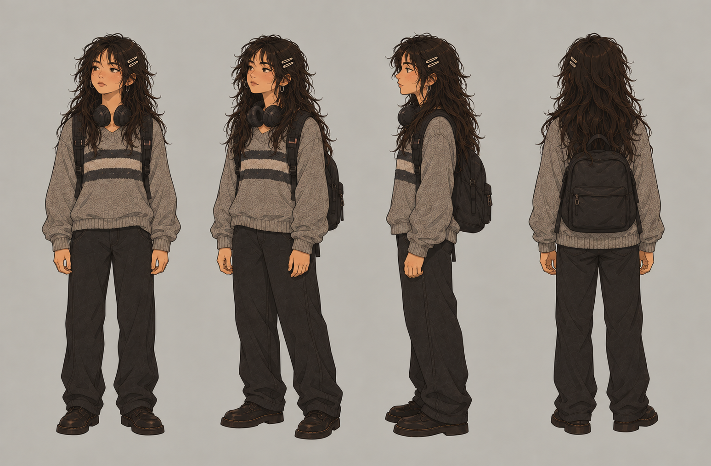
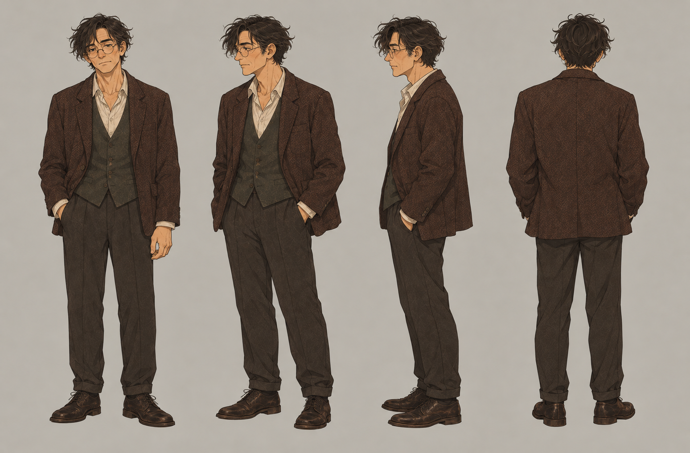

# EP1-H3-卡2-2｜发现信封被赶出（H3 视频生产卡）

> 📂 [[10-创作/二手书店的时间信封/信封发散树.canvas|信封发散树]] · [[10-创作/二手书店的时间信封/01_任务卡/00_信封任务卡规则与索引|锁卡规则及全索引]] · [[10-创作/二手书店的时间信封/01_任务卡/B1-EP1_H3_25镜逐镜描述词_生产包_V1_20261030|25镜H3生产包]]
> 本卡为 **H3 渲染生产卡**，记录 2026-10-30 实际提交与输出；剧情内容源自上述故事卡与 25镜生产包，均仍为待审候选。

**四段直达**：[[10-创作/二手书店的时间信封/01_任务卡/EP1_H3_卡2-2_发现信封被赶出.md#1_内容概括锁|📄 内容概括]] · [[10-创作/二手书店的时间信封/01_任务卡/EP1_H3_卡2-2_发现信封被赶出.md#2_画面与首帧锁|🖼 画面/首帧]] · [[10-创作/二手书店的时间信封/01_任务卡/EP1_H3_卡2-2_发现信封被赶出.md#3_分镜时间锁|⏱ 分镜时间]] · [[10-创作/二手书店的时间信封/01_任务卡/EP1_H3_卡2-2_发现信封被赶出.md#4_音效与视频锁|🎬 音效/视频]]

**当前阶段**：渲染候选（SUCCESS_CANDIDATE）｜四锁均未通过 USER 审核；不可把渲染成功当作分镜/身份已锁定。

## 1_内容概括锁

- **状态**：待 USER 审核（未锁）
- **一句话事件**：Claire 在书店翻出旧书里的信封、震惊惊叫，老板 Marcel 被打扰、合书指门将其赶出（对应故事卡「卡2-2｜发现信封至被赶出」）。
- **人物十元关系**：XN 仍是震惊与被迫离场；Marcel 为书店老板，N 立场（提供线索）在后续卡2-3 才展开，本卡仅呈现其被打扰与驱逐动作。
- **H3 覆盖**：卡2-2 原 7 镜中的 02-2-01/02/04/05/06 五镜合一（02-2-03 奇幻VFX待审不生成；02-2-07 出店携信为条件候选不生成）。
- **未决**：奇幻具体形态与能否带信出店仍待审；Marcel 身份不可冒认为祖母材料。

## 2_画面与首帧锁

- **状态**：待 USER 审核（未锁）；首帧为 USER 素材，作为最高视觉权威。
- **首帧（opening composition）**：`H3输出/LIN313_EP1_用户素材首帧_20261030/卡2-2_书店_首帧.png`，1672×941，SHA `9aae2892eabef1060326f4ed462a31b7be4433cd66e637c60da8f1587d8e7a08`。
  画面：暖色二手书店内景，Claire（左侧书架前持旧书）与 Marcel（右侧后景扶手椅中安静阅读）。
- **参考图**：
  - `ref_image_1`（Claire 身份锚｜2026-10-31 更新）：`10-创作/二手书店的时间信封/角色候选/Claire_B方向_三视图_简化几何边缘_H3参照_20261031.png`，SHA `3503D15DDCAE0E4E8C7A384005249A586747386B9EF4E216CCA8F2123A4140A9`；配套头像 SHA `3F17D491D61F8484905C0B2AB6165CD1DA94E43FD57205FC985DFC1FA0D7BF7D`。旧 `女主_四宫格.png`（SHA `5880E714…6DB9`）降为历史来源，下一次制作改用简化几何版。
  - `ref_image_2`（Marcel 身份锚）：`C:\work\ten-yuan-vault\老板正选.png`，SHA `0dca27a7dfdaee13199463ec6fb1007dd62c0d717a5685ba36d7639b9de4dbbf`。下一次制作使用此图作为身份参考。
- **接线模式（2026-10-31 更新）**：原 `MiniMaxH3ReferenceToVideo` 会按 prompt 重画构图（画风飘的根因），**已停用**。现走 `MiniMax H3 T8 Hybrid`（`AudioConditioningT8 → DualClockSamplerT8 → AVDecodeT8`）：`first_frame` 硬锁首帧，`ref_images.ref_image_N` 以 dotted path 挂身份图（最多9张），8 步 `dual_clock_euler` / `native_flow`。
- **锁定条件**：须明确审核首帧构图、双身份、暖灯调与输出一致性。
- **历史实际送入 H3 的图（此前版本，保留作记录）**（首帧＝最高视觉权威；参考图＝身份锚；SHA 见各 manifest）：
  - `ref_image_0`｜首帧（opening composition）：
  - `ref_image_1`｜Claire 身份锚：
  - `ref_image_2`｜Marcel 身份锚：

## 3_分镜时间锁

- **状态**：待 USER 审核（未锁）；以下为本卡提交给 H3 的分镜指令，模型是否严格照走需抽帧复核。
- **本卡 H3 合并分镜**（12.958s / 311 帧；压缩自 25镜生产包 02-2-01/02/04/05/06）：
  - SHOT 1｜0.0–1.8s：稳定中景，Claire 沿书架移动并注意到某本旧书，后景 Marcel 已在阅读，扰动前即确立。
  - SHOT 2｜1.8–3.5s：近俯拍特写，Claire 翻开旧书，书页间露出一枚奶油色纸信封；指尖触碰其边缘一次。
  - SHOT 3｜3.5–6.4s：固定极近脸特写，先一次怀疑眨眼、轻微凑近，继而挑眉睁眼真惊，结束于吸气前。
  - SHOT 4｜6.4–9.8s：中上景，Claire 从旧书猛然直立后仰，双肩回弹、张口一次自发惊呼，随即收住。
  - SHOT 5｜9.8–13.0s：硬切 Marcel 同位置反应镜，被惊扰后合书一次、抬头皱眉、抬臂指向正门，动作有因有止。
- **注意**：H3 ref 图驱动下，五镜顺序/「翻书现信封」「惊叫回弹」「老板指门」动作是否真实呈现为待审项；若输出仅轻微动首帧未完成上述动作，视为失败需重跑。

### 3a_分镜描述词
> 详见第 4 段 `PROMPT_USED` 全文；五镜按上述时码顺序以硬切连接。

### 3b_时间分镜描述词
> 见上表；原生 311 帧 / 24fps = 12.958s，剪辑目标 13s（正式影片保留卡2-2=13s）。

## 4_音效与视频锁

- **状态**：待 USER 审核（未锁）；已渲染 **候选**，非终版。
- **输出文件**：`H3输出/LIN313_EP1_用户素材首帧_20261030/card2_2_H3原始输出_311帧.mp4`
  - 原生帧 311 / 24fps / 12.958s；SHA `a2e82afd0e21d5cbcba995ebb378c63ab7a07fd3e0cb48bedc086a539cc77973`
  - prompt_id `b5bf64dc-224a-4048-9a96-e762927df1f4`；seed `202610301303`
  - workflow：`H3输出/LIN313_EP1_用户素材首帧_20261030/workflow_card2_2.json`
  - 抽帧：`H3输出/LIN313_EP1_用户素材首帧_20261030/逐镜抽帧/card2_2_f*.png`（首/中/尾）
- **音效**：本卡无原生音轨；后期候选：翻页与指尖触纸（SHOT2）、吸气（SHOT3）、中文配音「What the fuck?!」（SHOT4，USER原话）、合书与简短驱赶语（SHOT5），均待后期，不声称已合成。
- **PROMPT_USED（证据：本次确实把描述词写进 H3 工作流并提交）**：
  > Create ONE 13-second edited sequence with five DISTINCT film shots in exact order; each shot fills the screen, never a grid. <Picture 1> is the opening composition and the sole visual authority: a hand-drawn warm second-hand bookshop interior where Claire (dark wavy hair, hair clips, gray striped sweater, headphones, backpack) stands at the left bookshelf holding an old book, and Marcel (older man, dark hair, glasses, brown jacket) reads quietly in an armchair in the right rear. <Picture 2> is the exact Claire character design; <Picture 3> is the exact Marcel character design. Preserve the referenced hand-drawn 2D style, warm lamp-lit palette and stable proportions. SHOT 1, 0.0-1.8 seconds: stable medium shot, Claire moves along the shelf and notices one particular old book, while Marcel is visibly reading in the rear before any disturbance. CUT. SHOT 2, 1.8-3.5 seconds: close insert, Claire opens the old book and one cream paper envelope is revealed embedded between the pages; her fingertip touches its edge once. CUT. SHOT 3, 3.5-6.4 seconds: fixed extreme-close face shot of Claire; first a doubtful blink and a small lean closer, then her eyebrows rise and her eyes open in genuine shock, ending on an intake of breath. CUT. SHOT 4, 6.4-9.8 seconds: medium upper-body shot, Claire recoils upright from the old book, shoulders jerk back and her mouth opens for one spontaneous surprised exclamation, then stops. CUT. SHOT 5, 9.8-13.0 seconds: hard-cut reaction shot of Marcel in his same reading position; the scream interrupts him, he closes his book once, sharply looks up, furrows his brow and raises one arm to point toward the front door, the motion complete with a clear endpoint. Clear hard editorial cuts, restrained emotion. No dialogue audio, text, subtitles, invented characters, costume changes, face redesign, red hair, magic glow, photorealism, 3D, split screens, storyboard grid or extra fingers.

### 4b_模型与管线
- **引擎节点**：`MiniMaxH3ReferenceToVideo`（ref 图驱动，dotted path `ref_images.ref_image_0/1/2`）
- **基座 UNET**：`minimax_h3_ref2va_pruned_int8_convrot.safetensors`
- **LoRA（已停用）**：`minimax_h3_ref2v_turbo_4step_v0.1_comfyui_bf16.safetensors`（4 步 turbo，strength_model 1.0）为 2026-10-30 前历史配置；当前基线为 **8 步**（T8 Hybrid / Ref2VA PDD），不再加载 4 步 turbo。
- **CLIP**：`qwen3vl_32b_minimax_h3_nvfp4_awq.safetensors`（type minimax）
- **视频 VAE**：`minimax_h3_video_vae_int8_convrot.safetensors`；**音频 VAE**：`minimax_h3_audio_vae_fp32.safetensors`
- **采样**：BasicScheduler（simple, steps 4, denoise 1.0）＋ KSamplerSelect（res_multistep）＋ BasicGuider ＋ SamplerCustomAdvanced；RandomNoise seed `202610301303`
- **画幅/帧数**：width 1024 × height 576；length 311；fps 24；ref_image_size `match`
- **workflow（含完整模型栈与 SHA 实算绑定）**：`H3输出/LIN313_EP1_用户素材首帧_20261030/workflow_card2_2.json`

> ⚠️ **描述词是否被模型真正采用**：prompt 已写入并提交（上附原文为证）。**抽帧证据（AI 初判，仍待 USER 审）**：`card2_2_f155` 书页间奶油色信封特写（对应 SHOT2「翻书现信封」）、`card2_2_f309` Marcel 合书抬臂指门（对应 SHOT5）——分镜指令被模型真实执行，非仅首帧微动。最终裁决权在 USER 审片。

## 审阅与解锁纪律

四段顺序为 **内容概括 → 画面/首帧 → 分镜时间 → 音效/视频**。后一段不得倒逼修改前段；确需改前段时须标记解锁、重新审核并使后续锁失效。本卡为渲染候选，USER 审片依据 [674-173](https://linear.app/674/issue/674-173)；新视频事实登记 [674-289](https://linear.app/674/issue/674-289)。
