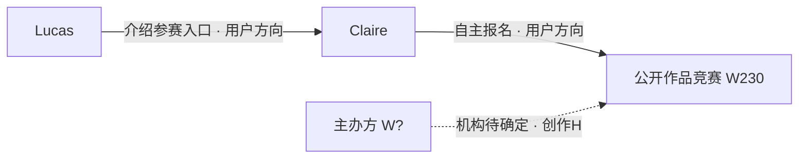
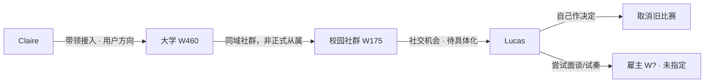
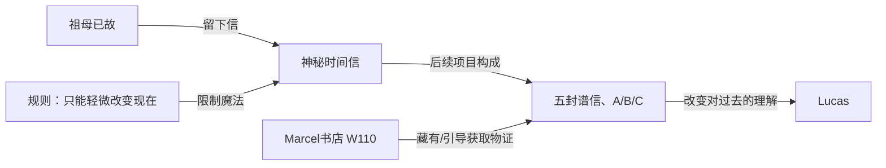

# R2｜《二手书店的时间信封》世界体量树：G / W 与类型化关系

> 本文件是**创作前世界模型**，不是成片事实清点。R1的30张是“研究材料”，本轮去重与分层后得到32个世界图节点（含世界参照、人物、制度、机构、地点、物件、事件及外部上下文）；38条分类清楚的关系。**32节点不等于32个独立组织**。完整机器数据：[R2 JSON](https://github.com/lukunanaron674-stack/-ten-yuan-vault/blob/main/10-%E5%88%9B%E4%BD%9C/%E4%BA%8C%E6%89%8B%E4%B9%A6%E5%BA%97%E7%9A%84%E6%97%B6%E9%97%B4%E4%BF%A1%E5%B0%81/05_%E4%B8%96%E7%95%8C%E6%9D%90%E6%96%99%E7%A0%94%E7%A9%B6/R2_%E4%B8%96%E7%95%8C%E4%BD%93%E9%87%8F%E6%A0%91_%E8%8A%82%E7%82%B9%E5%85%B3%E7%B3%BB_20261116.json)，原始材料：[R1 JSONL](https://github.com/lukunanaron674-stack/-ten-yuan-vault/blob/main/10-%E5%88%9B%E4%BD%9C/%E4%BA%8C%E6%89%8B%E4%B9%A6%E5%BA%97%E7%9A%84%E6%97%B6%E9%97%B4%E4%BF%A1%E5%B0%81/05_%E4%B8%96%E7%95%8C%E6%9D%90%E6%96%99%E7%A0%94%E7%A9%B6/R1_RAW_MATERIAL_PACKET_V1_30%E5%8D%A1_20261116.jsonl)。

**强边界**：2026-11-08 V4R2（Lucas让Claire进入公平作品比赛；Claire带Lucas接入大学社交/音乐工作）；11-10角色十元修订按674-313单列，不用旧人物标签覆盖；不替换三集13卡、现有H3执行卡或官方给定梗概。

## 0｜评分标尺与分账

- **G**（0–1000）：同[[15-总思路/世界观体量G与世界影响W_双标尺_跨作品比较_20261116]]的四个候选权重；仅收纳**作品里明确出现或用户已经决定采用**的社会世界。不把真实巴黎市政、RATP、BnF、所有大学直接计入故事已发生的社会展开。
- **W**（1–1000）：同作品内的持续社会影响力候选，用范围、准入约束、资源控制、持续性及跨关系作用比较。W1000=作品世界社会整体参照（W00），不是排名第1机构，W值不求和、不累加为G。
- **W?**：虚构赛事主办方与大学岗位雇主，具体规模和组织身份未确定。
- **W不适用**：每个单独人物、地点、关键道具及一次事件均不因戏份多而生成组织影响W。外部现实机构不被冒认成当前剧本组织。
- **E**（世界条件生成事件的能力）仍没有冻结公式，R3以后做条件删除与反例检验；本轮不填伪E数。
- **评分证据**：只有一次AI相对估值，未经过跨作品盲评、评分者一致性或实际成片检验。

## 1｜世界总体量G（**创作前候选，非成片G**）

|方案|地域与社会覆盖 /250|组织关系 /300|层级 /250|横向社会系统 /200|总G /1000|
|---|---:|---:|---:|---:|---:|
|**当前创作方向**|65|65|45|65|**240**|
|把可选外部机制真正写进作品后的拓展情境|75|90|55|70|**290**|
|实际成片|—|—|—|—|**未测**|

**G240解释**：只明确展开巴黎左岸局部、店铺与地铁音乐空间、Claire的大学、公开作品比赛与求职/社交入口；未形成城市市政体系、多国制度或完整大学机构层级。教育、音乐劳动、商贸和旧物记忆虽涉及多领域，但不是全部已经实际描写的社会系统。

**G290解释**：仅在创作阶段确实加入许可、具体主办方、用人机构或旧书多主体流通，并形成可演出的相互关系时才可能成立。R1外部来源本身不会提高G。对标《我们一起摇太阳》旧G260也只是校准线索，不代表新片已经达到此体量或更好。

## 2｜W：实际有足够轮廓的四个候选对象

|同作品对象|ID|W候选|可持续影响范围|证据限制|
|---|---|---:|---|---|
|Claire所在大学|W02|**460**|学生身份、校园生活、社交入口、潜在工作机会|大学未命名，内部制度未展开，极低置信估值|
|公开设计作品比赛机制|W04|**230**|参赛准入、比赛评审与结果；只作用于参与者|主办方与赛制未定；这是机制而非独立机构|
|大学学生及音乐社群|W03|**175**|同辈人际关系及可接触工作/活动信息|是群体，不是独立的大学下属社团|
|Marcel二手书店经营实体|W07|**110**|小范围交易与旧物信息接触|经营与物理店面分离，重要信件不抬升社会权力|

> 以上数字属于对**故事内部相对社会影响**的探索型估计，不是客观经济/法律事实；初期最好把它们当可修订的排序锚，未来有新社会节点再相互校准。真实RATP与市政府尽管现实中影响广泛，因未在故事中确认角色法定关系，均不填故事W。

**开放W**：W05作品比赛主办方=W?；W06大学岗位雇主=W?。人物、一次参赛、五封谱信、祖母生死、时间魔法、地铁演奏地点=**NOT_APPLICABLE**，不是W0。

## 3｜可读世界体量树（分类树，不是法定直属图）

```mermaid
flowchart TB
 R["时间信封：故事社会整体 W1000参照"]
 A["巴黎左岸局部社会｜G计划240"]
 B["大学与校园｜W460"]
 C["公开设计竞赛｜W230"]
 D["校园学生/音乐社群｜W175"]
 E["Marcel旧书店｜W110"]
 F["竞赛主办方｜W?"]
 G["工作岗位雇主｜W?"]
 H["RATP音乐人选拔｜现实参考，不计故事W"]
 I["塞纳河旧书摊｜现实参考，不计故事W"]
 J["时间魔法 / 五封谱信 / A-B-C｜叙事规则与物件，W不适用"]
 R -. "作品总体参照（非直属）" .-> A
 A -. "社会组成（非直属）" .-> B
 A -. "社会组成" .-> C
 A -. "社会组成" .-> E
 B --> |"社交连接（非隶属）"| D
 F -. "候选主办关系"| C
 G -. "候选招聘关系"| B
 R -. "背景待选，不进入G"| H
 R -. "背景待选，不进入G"| I
 R -. "高叙事作用 ≠ 高社会W"| J
```

## 4｜三个关键结构子网

### A. 公开竞赛与自主参赛



**作用**：该社会机制让角色进入公开评价，而不是Lucas代办。主办方是否存在可核报名资格、截止条件、评审权属需要R3才决定，不把旧同学抢署名带入新剧情。

### B. 校园社交与工作入口



**作用**：她提供现实关系和工作机会，他自己退出旧音乐竞赛，岗位是否录用仍开放。不得将工作试奏误当成旧竞赛。

### C. 旧书店、遗物与时间限制



**注意**：最初神秘信与五封谱信需要分ID；五封具体内容、留在书店的位置、A/B/C回收方式属导演候选，不是官方逐字设定。

## 5｜R2关系分层与统计

|关系证据层|条数|入图含义|
|---|---:|---|
|官方短梗概可支持|10|角色、店、地点、信件的原始事实|
|USER现行剧情方向|13|现阶段决定要写，但未意味着完成分镜|
|外部现实资料|7|只构成参考世界，默认不进入实际G|
|原创待审假设|8|主办方、物证、雇主与因果可选项|
|**合计**|**38**|每条边有ID、类型、端点、MAT回源|

不可画成正式父子边的关键关系：

- **大学 ↔ 学生社群**：社交与活动，不必是法定大学部门。
- **Lucas ↔ RATP计划**：官方仅说明他是地铁钢琴家，没有证明被RATP认可、受雇或获得特定badge。
- **Marcel旧书店 ↔ 市政书摊许可**：私有室内书店与河岸户外摊位不是同一个经营制度。
- **音乐工作雇主 ↔ 大学**：未指定雇主，不能自动说是大学直接聘用。
- **五封谱信 ↔ 祖母原始神秘信**：B版本的创作扩展，不意味着赛事原文规定五封。

## 6｜R3故事构成所需的优先采样点

|机制|删掉会导致什么|现在是否能判定|
|---|---|---|
|公开比赛的评价门槛|Claire是否仍需要克服公开评价的不确定性|部分；具体赛制未知|
|校园社交及求职渠道|Lucas能否从孤立比赛转向另一个稳定社会路径|部分；需要具体雇主与行动|
|旧谱留下的过去证据|祖母生前与Lucas的关系如何改变他当下的自我理解|部分；五封内容与检验待审|
|魔法只能轻微改变现在|是否还能保持人物主体性与时间不可逆|官方边界明确，事件效果未定|

**选择R3重点**：先写两个事件——①比赛入口的现实条件；②校园音乐工作接入条件；对两者做反事实删除，验证双向架桥是否不可替代。十元标签和观众感受延后论证。

## 7｜Canvas接入与安全审计

现有唯一Canvas：[[10-创作/二手书店的时间信封/00_项目总览.canvas]]。2026-11-16 只读审计：205节点/196边/7组，68未归组文字或文件节点，跨组边 `j_parent_i` 从I巴黎历史通向J音乐历史。

**判定：`FAIL_CLOSED_CROSS_GROUP_EDGE_KEEP_EXISTING`**。依[[07-Codex大脑库/skills/obsidian-canvas-layout/SKILL]] v1.5.1，跨中心语义归属尚未裁决时不得自动改动、复制或重排Canvas。R2因此只交付MD+JSON的可视化文字图；原Canvas保持原样。若后续人工确认该跨组连线为仅导航边，可以先保留其原ID与两个端点做迁移方案，再原位补一个R2资料入口，最后做零丢边校验及Windows实屏（WAIT_LOCAL_UI）。

## 8｜来源与停止点

- [R1材料30卡](https://github.com/lukunanaron674-stack/-ten-yuan-vault/blob/main/10-%E5%88%9B%E4%BD%9C/%E4%BA%8C%E6%89%8B%E4%B9%A6%E5%BA%97%E7%9A%84%E6%97%B6%E9%97%B4%E4%BF%A1%E5%B0%81/05_%E4%B8%96%E7%95%8C%E6%9D%90%E6%96%99%E7%A0%94%E7%A9%B6/R1_RAW_MATERIAL_PACKET_V1_30%E5%8D%A1_20261116.jsonl)
- [全体R2节点与类型边JSON](https://github.com/lukunanaron674-stack/-ten-yuan-vault/blob/main/10-%E5%88%9B%E4%BD%9C/%E4%BA%8C%E6%89%8B%E4%B9%A6%E5%BA%97%E7%9A%84%E6%97%B6%E9%97%B4%E4%BF%A1%E5%B0%81/05_%E4%B8%96%E7%95%8C%E6%9D%90%E6%96%99%E7%A0%94%E7%A9%B6/R2_%E4%B8%96%E7%95%8C%E4%BD%93%E9%87%8F%E6%A0%91_%E8%8A%82%E7%82%B9%E5%85%B3%E7%B3%BB_20261116.json)
- [现行V4R2剧情](https://github.com/lukunanaron674-stack/-ten-yuan-vault/blob/main/10-%E5%88%9B%E4%BD%9C/%E4%BA%8C%E6%89%8B%E4%B9%A6%E5%BA%97%E7%9A%84%E6%97%B6%E9%97%B4%E4%BF%A1%E5%B0%81/01_%E4%BB%BB%E5%8A%A1%E5%8D%A1/B1_%E4%B8%BA%E7%9B%AE%E6%A0%87%E5%A4%B1%E5%BA%8F_%E7%A5%96%E6%AF%8D%E4%BA%94%E5%B0%81%E4%BF%A1_%E4%B8%89%E9%9B%8613%E5%8D%A1_%E6%96%B0%E6%96%B9%E5%90%91_V4_20261031.md)
- [G/W候选双标尺](https://github.com/lukunanaron674-stack/-ten-yuan-vault/blob/main/15-%E6%80%BB%E6%80%9D%E8%B7%AF/%E4%B8%96%E7%95%8C%E8%A7%82%E4%BD%93%E9%87%8FG%E4%B8%8E%E4%B8%96%E7%95%8C%E5%BD%B1%E5%93%8DW_%E5%8F%8C%E6%A0%87%E5%B0%BA_%E8%B7%A8%E4%BD%9C%E5%93%81%E6%AF%94%E8%BE%83_20261116.md)
- [RATP地铁音乐人制度史](https://www.ratp.fr/coulisses-musiciens-du-metro)
- [巴黎市政府塞纳河旧书摊](https://www.paris.fr/pages/les-bouquinistes-et-paris-histoire-d-amour-en-majuscules-7886)
- [BnF乐谱资料](https://www.bnf.fr/fr/les-collections-de-partitions)

**R2阶段完成定义**：机器图端点、来源与关系类型全闭合，G计划候选与部分W相对值已登记，未将外部现实城市规模冒充故事世界，项目Canvas原件未更动。G实际成片、R3事件生成能力、4个W相对排序校准及影视审核仍未完成。
