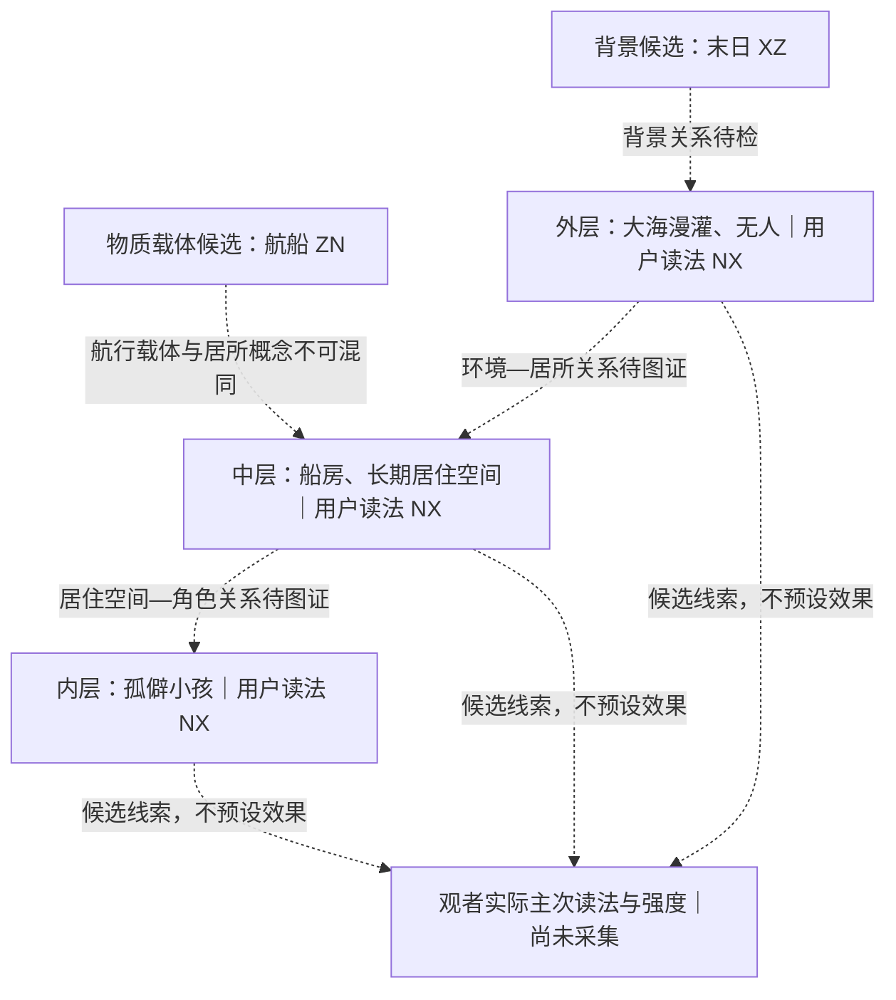

# USER 主观读法分支｜N1–N3 对象拆分与层级模型

> 来源：674-297 用户评论 `4b92a9ac-8ea7-4dd9-9359-ab26f8abdd90`，并对照校正评论 `784ed070-1186-406e-9c9d-c477aa376fc9`。
> 这是六条具体情境/概念读法与纸面创作研究卡，不是十元全局词典、角色审核 PASS、盲测报告或因果结论。与 297 原 G3 R1–R6 及新六轮知识分开编号。
> 三组基础对照卡：[[G3_USER_SCENE_READING_CONTRAST_CARDS_20261008]]。主 Canvas 和旧 G3 文档保留原样。

## N1｜对象与感受层分离：六个对象卡

| 被判断对象 | 所属层 | 用户给出的条件/概念焦点 | 主候选（用户原读法） | 次候选 | 证据状态 |
|---|---|---|---|---|---|
| 船夫 | 角色职业 | 把“船夫”作为职业角色名词来读 | `XZ` | `UNKNOWN / 未给出` | `USER_REPORTED_SCENE_READING`；没有逐人视觉/行为审核 |
| 末日 | 世界事件/状态 | 把“末日”作为世界事件或背景状态来读 | `XZ` | `UNKNOWN / 未给出` | `USER_REPORTED_SCENE_READING`；不是所有末世场景的固定读法 |
| 航船 | 物件/交通载体 | 以航行、运输功能为焦点 | `ZN` | `UNKNOWN / 未给出` | `USER_REPORTED_SCENE_READING`；不是居住状态 |
| 大海漫灌、无人 | 外层世界空间/存在状态 | 海水漫灌与空无一人合成的环境意境 | `NX` | `UNKNOWN / 未给出` | `USER_REPORTED_SCENE_READING`；这是组合条件，不等同于“无人”单词 |
| 船房 | 中层居住空间 | 作为船上房屋/栖居空间来判断；实际形态待图确认 | `NX` | `UNKNOWN / 未给出` | `USER_REPORTED_SCENE_READING`；没有视觉形态证据 |
| 孤僻小孩 | 内层角色身份/性格意境 | 把“孤僻小孩”作为角色概念来读 | `NX` | `UNKNOWN / 未给出` | `USER_REPORTED_SCENE_READING`；不能简化成“孤独=NX” |

**N1 完成口径：**六行都回答了“判断谁/什么、属于哪层、哪些条件在场”。六个值只在用户给出的具体读法范围内成立；没有把“船夫=XZ”“船房=NX”等升成跨情境定理。

## N2｜三组最小差异卡：差异、反例和缺口

| 对照 | 可检验差异（假设） | 什么情况会推翻简单解释 | 目前缺的证据 | 比较性质 |
|---|---|---|---|---|
| 航船 `ZN` ↔ 船房 `NX` | 是否把同一类船体读作航行/运输载体，或读作可长期栖居的房屋；关注功能、生活痕迹、内外边界 | 若“船房”没有栖居线索仍稳定被读为 `NX`，或有清楚栖居线索却仍主要读成 `ZN`，就不能用“栖居功能导致 NX”概括 | 可确认的船房图/行为；清楚的航行与居住证据；用户针对不同呈现的实际读法 | **对象/概念焦点切换**，不是真正单变量因果对照 |
| 末日 `XZ` ↔ 大海漫灌、无人 `NX` | 后者比“末日”多了淹没空间关系和无人状态；要分开检查词面、空间线索和人的存在/缺席 | 若带有救援者、互助行动的漫灌场景仍读成 NX，或只给“无人”并未读成 NX，表示“漫灌+无人”不能被压成单词规则 | 经审核的可见水位/岸线/人员线索；分别呈现词面与画面条件的用户报告 | **多个条件叠加的环境意境对照**，不是单因素对照 |
| 船夫 `XZ` ↔ 孤僻小孩 `NX` | 比较的是职业角色与另一身份/性格意境的对象差异；记录具体行为、服务关系和社交互动 | 若船夫呈现独处但仍读成 XZ，或小孩呈现互助/主动交往仍读成 NX，说明标签不能由职业或性格词直接推广；反向情况也需保留 | 同等清楚、来源合规的角色呈现；谁在做什么、与谁互动；用户逐角色读法 | **不同角色对象对照**，不是同一角色的 NX 强度变化 |

反例是待检验情境，不代表用户已报告这些读法。当前三组的次候选、竞争十元和强度均 `UNKNOWN`。

## N3｜三层 NX 嵌套模型

### 层级示意

以上箭头是需要检查的层级/关系，不表示因果已成立。“船夫 `XZ`”是另一角色对象，单独建卡；不能把它塞进内层小孩或场景整体读法。

### 相互作用预测表（全部待检）

| 呈现条件 | 纸面预测 | 应同时记录的竞争/替代读法 |
|---|---|---|
| 外层漫灌无人 + 船房 + 孤僻小孩 | 三层若各自提供独立可见线索，可能出现同向支持；也可能彼此重复，不能预报 NX 强度必然上升 | `XZ` 末日背景、`ZN` 航行物件、其他用户自发报告；目前均无分数 |
| 去掉外层环境，只留船房 + 小孩 | 检查居所与角色是否仍能支撑 NX 候选；若方向不变，外层环境可能冗余 | 居所安全/功能、角色自身读法；未测 |
| 去掉船房，只留漫灌无人 + 小孩 | 检查中层栖居是否承担连接环境与人物的作用 | 环境危险、儿童身份/行为的竞争解释；未测 |
| 去掉小孩，只留环境 + 船房 | 检查 NX 是否来自环境/居所，还是依赖角色存在 | `XZ` 背景和 `ZN` 载体仍分开；未测 |

### 三条可推翻“嵌套同向支持 NX”假设的反例

1. **线索齐全但读法不支持 NX：**可见漫灌、船房生活痕迹和小孩，真实读者仍稳定先报 `XZ`、`ZN` 或其它非 NX 方向。则“三层同向”不能代表观者主读。
2. **去层不改变读法：**逐层移除环境、船房或小孩后，主读法及其强度没有可辨变化；这说明相应层的独立贡献未显示，可能冗余或不可辨。
3. **对象焦点与模型不符：**读者持续把画面判断为航行交通工具、末日背景或某一角色，而没有把环境—居所—人物理解成嵌套结构。此时应按实际 object_of_judgment 重分层，不能硬套嵌套模型。

## N4｜准入状态

状态：`BLOCKED_VISUAL_OR_REVIEW`。六条 USER 概念读法可以保留为第一人称报告；它们不构成 N4 要求的“名称提示 vs 遮字图 vs 事件行为”素材对照或用户逐刺激报告。当前 674-296 为 `A_READY=0 / WAIT_REVIEW=5 / BLOCKED_4080=5`，N4 需等到来源和审核范围明确、可合法使用的真实素材与逐刺激报告。若没有真实报告，N4 不能标实证 DONE。

本文件没有生成素材、没有启动 H3/盲测、没有新领 S1–S6 实验槽，也没有更改旧 G3 研究稿、主控 Canvas、角色审核状态或十元本体定义。