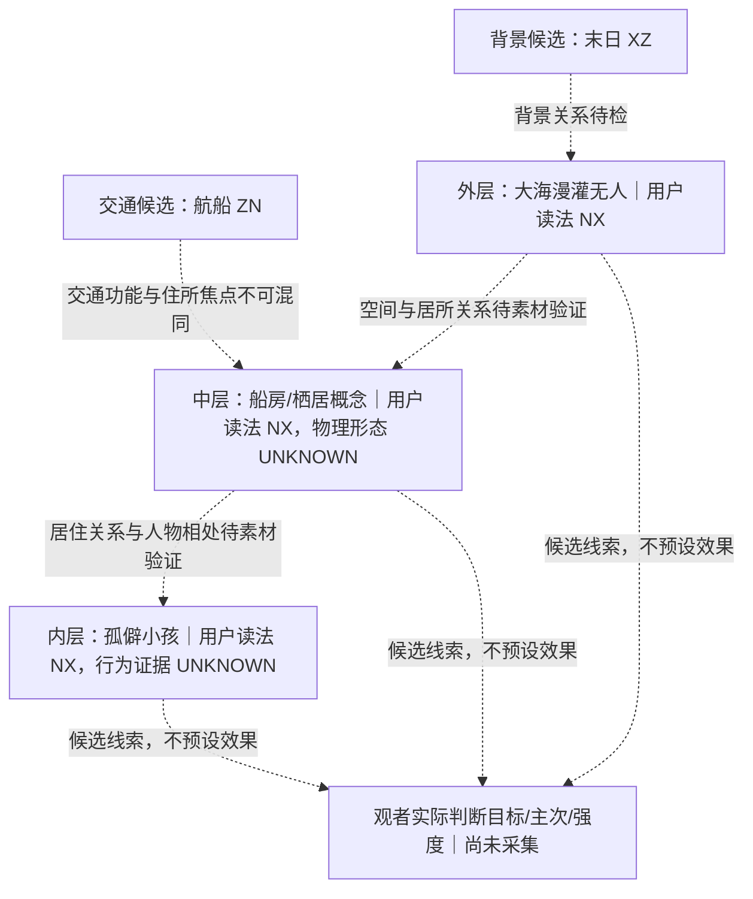

# USER 主观读法分支｜N1–N3 对象拆分与层级模型 v2

> v2 按用户更细的 N1 标准补齐“物理对象 / 概念对象 / 判断目标 / 观看条件 / 判断来源”，并修正“船房”形态未定的边界。此前两份卡片仍保留作版本追溯；本版作为当前工作稿。
>
> 来源：Linear 674-297 评论 `784ed070-1186-406e-9c9d-c477aa376fc9`、`4b92a9ac-8ea7-4dd9-9359-ab26f8abdd90`、`da9f8855-70ad-4346-9acb-c9898f1c4193`。内容是用户对六个具体词语/构想的第一人称读法与纸面研究假设，不是正式十元词典、图像 USER PASS、盲测报告或因果结论。与 297 原 G3 R1–R6 及新六轮知识分开编号。

## 判读原则

- `USER十元` 只保留在用户给出的具体概念条件中；不推广成同词全局定律。
- `物理对象` 是实际画面里的实体；未看到图时写 `UNKNOWN`。`概念对象` 是观者理解的功能、角色或处境；不能与物理实体混为一谈。
- `判断目标` 明确是物件、人物、组织、局部居所、宏观环境还是整体意境。不同层级可以各有读法，不天然互斥。
- 名词联想、实际可见线索、行为/关系与观看窗口分开记。未给出的次候选/竞争十元写 `UNKNOWN`。
- 这是用户报告和创作研究卡，不把假设当观众数据；三个 NX 标签并列不代表叠加后强度必然增加。

## N1｜六个对象卡

字段模板：`source_quote | mention_name | judged_entity | entity_kind | function_or_relation | framing_window | observer_focus | user_reported_ten_yuan | expected_visible_evidence | still_unknown | evidence_class`。

### N1-01｜船夫

- 原词/来源句：“船夫”→ **XZ**。
- `mention_name`：船夫。
- `judged_entity`：人物（物理人物当前 `UNKNOWN`）；概念上是从事船上/航运工作的职业角色。
- `entity_kind`：人物 / 职业角色。
- `function_or_relation`：行动人、职责、服务对象与所处关系要分开；具体均未给定。
- `framing_window`：目前是名称/职业概念；未来有视觉材料时再区分词面与行动窗口。
- `observer_focus`：观者是在读“船夫”这个职业名称，还是在读这个具体人的职责、行动和处境。
- `user_reported_ten_yuan`：主 `XZ`；次候选 `UNKNOWN`。
- `expected_visible_evidence`：尚无实际证据；未来可核对其行动、职责、服务对象和情境关系。
- `still_unknown`：人物身份、实际行为、个人关系、视觉来源、其它十元读法。
- `evidence_class`：`USER_REPORTED_SCENE_READING`（概念/名词主观读法）。
- 当前不能推出：所有船夫固定 `XZ`；人物本体属性已冻结。

### N1-02｜末日

- 原词/来源句：“末日”→ **XZ**。
- `mention_name`：末日。
- `judged_entity`：宏观世界事件/总体状态；实际世界及事件表现 `UNKNOWN`。
- `entity_kind`：世界事件 / 宏观叙事框架。
- `function_or_relation`：需分清这是词面标签，还是从世界后果、事件变化与人物处境读出的状态。
- `framing_window`：事件之前、发生期间、之后的时间窗口都未指定。
- `observer_focus`：观者读到“末日”一词，还是从可见的灾变后果理解具体世界状态。
- `user_reported_ten_yuan`：主 `XZ`；次候选 `UNKNOWN`。
- `expected_visible_evidence`：没有对应画面；未来需记录实际灾变后果和时间信息，而非预填。
- `still_unknown`：末日具体含义、可见后果、时间范围、人物与环境状态。
- `evidence_class`：`USER_REPORTED_SCENE_READING`。
- 当前不能推出：所有灾后环境都为 `XZ`；“无人”必然是 `NX`。

### N1-03｜航船

- 原词/来源句：“航船”→ **ZN**。
- `mention_name`：航船。
- `judged_entity`：物理船体 `UNKNOWN`；概念上是航行载体/交通用途。
- `entity_kind`：物件 / 交通结构。
- `function_or_relation`：以航行、运输、运行功能为焦点；不能因此断定船体所有视角只有这一功能。
- `framing_window`：目前为词面/功能概念；未来可区分外部运行镜头与内部生活镜头。
- `observer_focus`：结构与航行功能是否是观者的判断目标。
- `user_reported_ten_yuan`：主 `ZN`；次候选 `UNKNOWN`。
- `expected_visible_evidence`：尚无图；未来可查看结构、航线操作、运输或航行行为是否清楚可见。
- `still_unknown`：具体船体、尺寸、航行情境，以及它是否与“船房”指同一物理实体。
- `evidence_class`：`USER_REPORTED_SCENE_READING`。
- 当前不能推出：同一船体永远只有 `ZN`。

### N1-04｜大海漫灌无人

- 原词/来源句：“大海漫灌、无人”→ **NX**。
- `mention_name`：大海漫灌无人。
- `judged_entity`：复合空间与无人存在状态；实际空间/画面 `UNKNOWN`。
- `entity_kind`：宏观环境 / 场景关系 / 人员存在状态。
- `function_or_relation`：把水域漫灌尺度、海水与地物关系、有人/无人及可否返回分开理解。
- `framing_window`：目前是整体环境意境；未来需区别局部空镜与“整个世界无人”的叙事窗口。
- `observer_focus`：观者判断的是海、漫灌造成的空间关系，还是无人/不可返回的整体处境。
- `user_reported_ten_yuan`：主 `NX`；次候选 `UNKNOWN`。
- `expected_visible_evidence`：尚无图；未来需看到水面/地物关系、漫灌尺度、人物有无及可返回线索。
- `still_unknown`：漫灌尺度、具体场景、有人情况、可返回性、空间边界。
- `evidence_class`：`USER_REPORTED_SCENE_READING`。
- 当前不能推出：仅凭海水或空镜就能判 `NX`。

### N1-05｜船房

- 原词/来源句：“船房”→ **NX**。
- `mention_name`：船房。
- `judged_entity`：实际物理形态 `UNKNOWN`；可能是房间、改装成住所的船，或水上屋。此处不替用户选定。
- `entity_kind`：居住空间 / 船相关栖居概念；具体类别待用户或真实图像确认。
- `function_or_relation`：栖居功能、空间边界、生活痕迹是未来需辨别的条件；尚无实物证据。
- `framing_window`：目前是词面/住所概念；长期生活时间窗尚未由素材证明。
- `observer_focus`：观者是在判断船体、船内房间、住所功能，还是与外界的生活关系。
- `user_reported_ten_yuan`：主 `NX`；次候选 `UNKNOWN`。
- `expected_visible_evidence`：没有对应图片；形态和居住用途仍待看图，不能补造生活痕迹。
- `still_unknown`：具体形态、是否船舱、是否改装船、居住者、使用时间、外部边界。
- `evidence_class`：`USER_REPORTED_SCENE_READING`。
- 当前不能推出：船房必然是船舱；`NX` 由孤独直接导出。

### N1-06｜孤僻小孩

- 原词/来源句：“孤僻小孩”→ **NX**。
- `mention_name`：孤僻小孩。
- `judged_entity`：实际儿童/人物 `UNKNOWN`；概念对象含“小孩”身份与“孤僻”相处倾向两个部分。
- `entity_kind`：人物身份 + 社会相处/角色关系判断。
- `function_or_relation`：儿童身份与可观察的社交行为要分列，不能把性格词当成行为证据。
- `framing_window`：目前为名称/性格意境；未来需区分一次动作与持续相处状态。
- `observer_focus`：读者是响应“孤僻”这个词，还是从回避、回应延迟、空间距离等可见行为判断。
- `user_reported_ten_yuan`：主 `NX`；次候选 `UNKNOWN`。
- `expected_visible_evidence`：尚无图；未来若有素材，记录回避/回应/距离行为是否持续且可辨。
- `still_unknown`：儿童身份、社交处境、行为持续性、角色关系、视觉来源。
- `evidence_class`：`USER_REPORTED_SCENE_READING`。
- 当前不能推出：小孩固定 `NX`；“孤独=NX”。

**N1 口径**：六个判断目标分属人物职业、世界事件、交通物件、复合环境、居住空间、人物关系意境。六项可以在同一个构想中并存，但目标对象不同；不推出多项 `NX` 叠加后自然更强。

## N2｜三组对照预研

| 对照 | 可检验的差异问题 | 反例/推翻检查 | 缺失证据 | 配对性质 |
|---|---|---|---|---|
| 航船 `ZN` / 船房 `NX` | 是同一船体切换观看焦点，还是两个物理对象？观者读到的是航行结构/操作，还是住所功能/生活关系？ | 叫“船房”但画面只有航行控制台时，是否仍读 `ZN`？同一船体若内外功能读法不同，是否是目标结构层切换而非船本体变元？ | 船房实际形态、用户是否指同一船体、具体图像/行为、生活用途与航行功能的可见范围 | 可能为不同对象，也可能是同实体不同概念焦点；目前 `UNKNOWN`，不是已控变量对 |
| 末日 `XZ` / 漫灌无人 `NX` | 差异来自“末日”词面，还是漫灌尺度、海水—地物关系、无人状态、可返回性与观看窗口？ | 漫灌但有救援船和聚居活动时读法如何？仅有局部空镜是否被误当成整个世界无人？ | 真实画面、有人/无人、漫灌范围、地物关系、时间窗口及用户逐项报告 | 宏观事件标签与空间/人员关系意境；多条件对照，非单变量 |
| 船夫 `XZ` / 孤僻小孩 `NX` | 差异来自职业职责与行动关系，还是身份/性格词及持续社交行为？ | 船夫独处是否仍读 `XZ`？小孩与人热闹交流是否仍读 `NX`？不能用标签代替行为 | 合规的真实角色图像/行为、角色分别的互动与时间线、用户逐角色报告 | 不同人物对象对照，不是同角色十元变化 |

词面、功能、可见空间、行动、与他人的关系和镜头窗口是待分辨因素。反例是检验条件，不是已观测结果。当前次候选、竞争十元、强度均 `UNKNOWN`。

## N3｜三层 NX 嵌套构成：模型和可推翻预测

### 层级示意

图中关系是层级假设，不是因果图。船夫 `XZ` 是另一人物对象，不塞进人物内层或整体画面标签。

### 相互作用预测（纸面假设）

| 条件 | 待观察预测 | 需要保留的竞争结构 |
|---|---|---|
| 外层漫灌无人 + 中层船房 + 内层孤僻小孩 | 三个目标若各有独立、清楚线索，观者可能分别读出三项，也可能不把它们理解成嵌套结构；不预言总强度增加 | 背景 `XZ`、交通载体 `ZN`、观者自发其它读法 |
| 去外层环境 | 检查船房与小孩读法是否保留；外层可能有支持、遮蔽或冗余 | 船房形态仍未定；不把变化归因给单一层 |
| 去中层船房 | 检查外层与小孩是否仍被理解成同一个生活处境 | 住所与交通功能不得互换 |
| 去内层小孩 | 检查环境/居所是否仍构成同一意境，或只剩世界状态与物件 | 角色层结果与整体场景结果分别记录 |

### 三个能推翻“嵌套同向支持 NX”的反例

1. 三层线索齐全，但用户/观者的主要判断持续落在 `XZ`、`ZN` 或其它读法上；嵌套同向假设不成立。
2. 逐层拿掉环境、船房或小孩，判断目标/主次/强度都没有可辨变化；相应层的独立支持没有显示，可能冗余或不可区分。
3. 观者持续只判断交通工具、末日背景或单一角色，未把空间—居所—人物理解成嵌套关系；应按实际 `object_of_judgment` 重分层，不套用该模型。

## N4｜素材和审核门

状态：`BLOCKED_VISUAL_OR_REVIEW`。六个 USER 概念读法可保留为第一人称报告；它们不等同于 N4 要求的“名称提示 vs 遮字图 vs 事件行为”真实素材对照或逐刺激报告。674-296 当前 `A_READY=0 / WAIT_REVIEW=5 / BLOCKED_4080=5`。需等待来源/审核范围清楚、可访问的真实素材及用户逐项报告；若没有实际报告，不标实证 DONE。

## 执行边界

- N1 已完成概念对象识别；`船房`物理形态消歧和所有真实视觉验证仍待确认。
- N2、N3 为文字/镜头创作预研和可推翻的预测，不填真实受众结果。
- 没有新图、H3、参与者、盲测、因果结论；没有新领实验槽。
- 不改十元本体正本、旧 G3 稿、主控 Canvas、审核值或 674-296 状态。